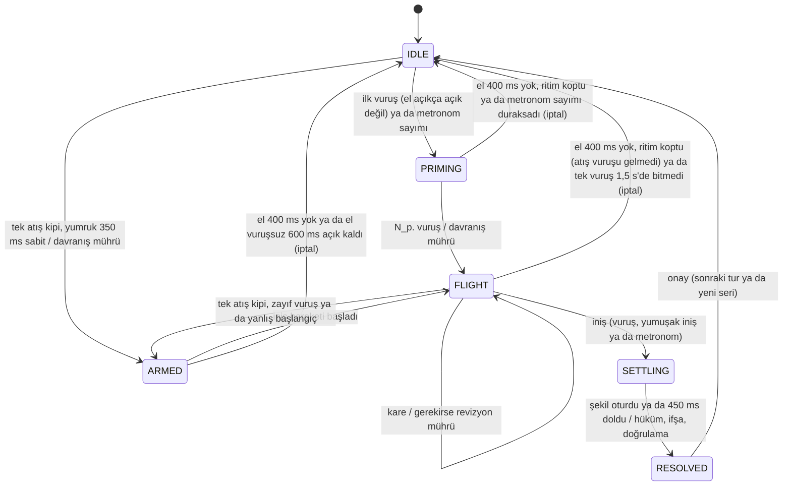

# 5. Sistem Tasarımı ve Gerçekleme

Bölüm 5.1 önceki sürümün denetimidir ve ayrı dosyadadır: [5.1 Önceki Sürümün Denetimi](05a-onceki-surum-denetimi.md).
Aynı dosyanın son alt bölümü (5.1.6), v4'ün kendisine uygulanan bağımsız incelemeyi ve bu bölümde
anlatılan tasarımın o incelemeden sonra nasıl değiştiğini özetler. Bu dosya 5.2'den başlar ve kodun
**inceleme sonrası** hâlini, ilk gerçek kamera denemesinden sonraki değişikliklerle birlikte betimler
(Bölüm 5.7).

## 5.2 Mimari

Sistem derleme adımı olmayan, yalnızca tarayıcıda çalışan ES modüllerinden oluşur (`web/js`). Beş katman
vardır ve bağımlılıklar yalnızca aşağıya doğrudur:

```
ui  →  app  →  core  ←  sim
        ↓
     platform
```

- **core**: saf (DOM'suz, global durumsuz) bilim çekirdeği. Zaman ve rastgelelik dışarıdan verilir; bu sayede
  aynı kod tarayıcıda, Node.js testlerinde ve deneylerde çalışır. Her modül ayarlanabilir sabitlerini
  dondurulmuş bir `DEFAULTS` nesnesinde tutar (Ek A).
- **sim**: sentetik el ve davranış oyuncuları. Ürettiği kareler gerçek kamera kareleriyle **aynı motordan**
  geçer; testlerin, deneylerin ve kamerasız demonun tek giriş noktasıdır.
- **platform**: tarayıcı bağdaştırıcıları (kamera, el izleyici, gizlilik çizeri, ses, yerel depo, isteğe
  bağlı bulut).
- **app**: denetleyici, kare kaynakları ve gözlemlenebilir depo; bilim ve DOM içermez.
- **ui**: görünümler. Kullanıcıya görünen bütün metinler ve sayı biçimleri tek dosyadadır (`strings_tr.js`).

| Dosya | Sorumluluk | Başlıca işlevler |
|---|---|---|
| `core/constants.js` | Hamle kodlaması, kazanç, eklem düzeni, hakem ön ayarları | `beats`, `payoff`, `RULES` |
| `core/math.js` | Sayısal yardımcılar; hiçbir işlev NaN döndürmez, boş örneklemin istatistiği hata verir | `wilsonInterval`, `binomTailGE`, `minJerk`, `quantile` |
| `core/rng.js` | Tohumlu üreteç (yinelenebilirlik) ve kriptografik üreteç (nonce, karma strateji) | `makeRng`, `cryptoRng`, `randomBytesHex` |
| `core/sha256.js` | Eşzamanlı SHA-256 ve bağımsız Web Crypto yolu | `sha256Hex`, `sha256HexAsync` |
| `core/commit.js` | Özet zincirli taahhüt–ifşa kaydı (D2, D3); isteğe bağlı duvar saatiyle `sealedAt` damgası; `lastRound()` kayıttaki en büyük tur numarasını verir | `createCommitLog`, `verifyRevealed`, `verifyExport` |
| `core/filters.js` | Sabit hızlı Kalman süzgeci, 1-euro (yalnızca görüntüleme), çevrimiçi istatistikler | `Kalman1D`, `OneEuroFilter` |
| `core/kinematics.js` | 21 noktadan açı tabanlı, dönme/ölçek/ayna değişmez öznitelikler | `fingerFlexion`, `extension`, `frameFeatures` |
| `core/stroke.js` | Ritim, uçuş evreleri, iniş ve iniş kestirimi; olaylar: `descentStart`, `apex`, `bottom`, `weakBottom`, `falseStart`, `rhythmReset` | `createStrokeTracker`, `predictLanding` |
| `core/opening.js` | Açılma başlangıcı için Bayesyen eşleşmiş süzgeç bankası; tek atış kipi için ızgara kaydırma | `observe`, `headingNow`, `evidence`, `slide`, `measureOpening` |
| `core/pose.js` | İniş sonrası durağan şekil sınıflandırıcısı (yalnızca hakem için); sınıfa özgü şablon sapmaları | `decideFinal`, `completionTime` |
| `core/decision.js` | İki kanalın füzyonu, hakemin yasal kümesi, karar ve revizyon kuralları, füzyon ağırlıklarının öğrenilmesi | `fuse`, `foulNow`, `legalMassFor`, `chooseAction`, `shouldRevise`, `learnFusionWeights` |
| `core/sequence/*` | Davranış kanalı: 26 uzman, CTW, PPM, topluluk önseli, karışım | `createSequenceModel`, `createMixture` |
| `core/safety.js` | Bütçeli güvenli sömürü (Önerme 1) | `decide`, `account` |
| `core/player_model.js` | Bir oyuncu hakkında öğrenilen her şey; sürümlü tek JSON belgesi. `learnFromRound` yalnızca geçerli turlarda, `learnPosture` (algılayıcı kalibrasyonu) belirli geçersiz turlarda da çağrılır | `learnFromRound`, `learnPosture`, `onsetPrior`, `toJSON`, `load` |
| `core/round_engine.js` | Tur durum makinesi ve hakem; dürüstlük değişmezleri burada zorlanır | `pushFrame`, `snapshot`, `acknowledge`, `armMetronome`, `abortRound` |
| `core/metrics.js` | Değerlendirme ölçütleri (Bölüm 4.10): koşullu (`winRate`, `lossRate`, `unbeaten`, `pValueVsChance`) ve koşulsuz (`attemptWinRate`, `noResultRate`, `voidRate`) oranlar, `kinematicLeadMs`; yüklenen belgenin tutarlılık denetimi | `record`, `summary`, `load` |
| `core/mindtwin.js` | Parmak açıklığının 120 ms ilerisi için öngörü ve ölçülen becerisi | `createTwinPredictor` |
| `sim/hand_model.js` | Açıklıklardan 21 noktaya ileri kinematik (çekirdeğin tam tersi) | `handLandmarks` |
| `sim/kinematic_player.js` | Bir turun karelerini üreten sentetik el. Varsayılan olarak dedektörün varsayımlarıyla **eşleşmiştir**; `perturb` seçeneği bu varsayımları bilerek bozar (Bölüm 6.8) | `simulateThrow`, `STYLES`, `PROFILES` |
| `sim/behaviour_players.js` | Sentetik davranış oyuncuları | `makePlayer` |
| `sim/session.js` | Sentetik oyuncu + gerçek motor oturumu | `createSession`, `runSession` |
| `platform/camera.js` | Kamera edinimi (sıralı başlatma: geçilmiş bir başlatma edindiği akışı durdurur), kare başına tek geri çağrı, yakalama zaman damgası, aygıt kaybının bildirimi (`onLost`) | `createCamera` |
| `platform/hand_tracker.js` | MediaPipe jest tanıyıcı bağdaştırıcısı; kitaplık, sürümü sabitlenmiş tek dosyadan yüklenir; GPU öncelikli, CPU yedekli; yüklemede ısınma; sürekli hatada öteki temsilciye geçiş; kullandığı temsilci (`delegate`: GPU ya da CPU); kalıcı hata bildirimi (`onFailure`) | `createHandTracker` |
| `platform/hand_focus.js` | Kameradaki gizlilik korumalı görüntü: görüntünün tamamı bulanık, yalnızca izlenen el net (Bölüm 5.8); net bölgenin ve `object-fit: cover` izdüşümünün saf geometrisi | `createHandFocus`, `handMaskGeometry`, `coverFit` |
| `platform/storage.js` | Yerel depo ve bellek içi ayna, ayar doğrulama, profiller | `createStorage`, `sanitiseSettings` |
| `platform/cloud.js` | İsteğe bağlı anonim istatistik eşitleme: tek bir veritabanı işlevine tek çağrı; gönderilen satırı `roundPayload` kurar | `createCloud`, `roundPayload` |
| `platform/audio.js` | Ses kliklerinin ses saatinde zamanlanması ve iptali (`cancelMetronome`), Türkçe sesli sayım | `createAudio` |
| `app/controller.js`, `app/sources.js`, `app/store.js` | Oyun akışı ve yaşam döngüsü (Bölüm 5.4.1), kare kaynakları (kamera / demo), durum deposu; eylemler arasında `abortRound` ve `exportData` (Bölüm 5.5) | `createController`, `createDemoSource`, `createCameraSource` |

## 5.3 Kare boru hattı

Önceki sürümde kinematik çizim döngüsünde hesaplanıyor, aynı kamera karesi birden çok kez "yeni gözlem"
sayılıyordu (Bölüm 5.1.3). Yeni boru hattında her **kamera karesi** tam bir kez işlenir:

```
kamera karesi → el izleyici (21 nokta, ham) → HandFrame{t, index, image, world}
   → frameFeatures (açılar, açıklıklar, avuç merkezi)
   → stroke.push (ritim, iniş)            → olaylar
   → opening.observe (ön ve arka grup)    → h_F, h_B, kanıtlar
   → decision (füzyon, yasal küme, seçim) → gerekirse mühür (commit)
   → depo (20 Hz'e seyreltilmiş anlık görüntü) → görünümler
```

Zaman damgası, tarayıcı sağlıyorsa karenin yakalanma zamanı, yoksa sunum zamanıdır [WICGrvfc2024]; zaman
damgası **ya da dizini** bir öncekini aşmayan kareler atılır. Kare sırası böylece iyi tanımlıdır; D1'in
"inişten önce" sınaması yalnızca bu sıraya dayanır (Bölüm 4.4). İzleyiciden gelen noktalar süzülmez (Bölüm 4.3'teki bağımsız
gürültü varsayımı). İniş, aynı karedeki değerlendirmeden **önce** işlenir: inişi getiren kare hiçbir zaman
taahhüt üretmez (D1).

**Motordan sonra kare başına model yok.** Kamera görüntüsünün gizlilik korumalı hâli (yalnızca el net; Bölüm
5.8) kare boru hattında değil, ekrana çizim sırasında üretilir; motor bir kareyi işledikten sonra kare başına
çalışan bir model yoktur. Kamera kaynağı izlediği her kareyi bir kez bir tuvale kopyalar: el izleyici bu
kopyayı okur, çizer de aynı kopyayı o karenin **ham** noktalarıyla birlikte kullanır. Net bölge böylece
noktalarının çıkarıldığı karenin üstüne çizilir, `<video>` öğesinin çizim anında gösterdiği daha yeni bir
kareye değil. Bedeli şudur: gizlilik açıkken gösterilen görüntü, canlı kameranın yaklaşık bir izleyici
çıkarımı kadar gerisindedir. İlk izlenen kare gelene kadar çizer canlı video öğesini kullanır. Önceki
gerçeklemelerin yüz dedektörü kaldırılmıştır: ilk v4 gerçeklemesinde el izlemeden önce çalışıp her mührü
kendi çıkarım süresi kadar geciktiriyor (Bölüm 5.1.6), inceleme sonrasında motordan sonra çalışıyordu. Kamera
açılırken onu en çok 6 s bekleyen adım da kalkmıştır. Ekrana çizim ayrı bir döngüdedir
(`requestAnimationFrame`); bu döngü önce kendini yeniden kurar, sonra her çizeri ayrı ayrı korumalı çağırır:
bir çizerin hatası ötekileri ve döngüyü durdurmaz.

## 5.4 Tur durum makinesi



`commit()` yalnızca ARMED ve FLIGHT evrelerinde çağrılabilir; başka bir evrede çağrılırsa hata fırlatır. Tek
atış kipinde davranış mührü ARMED'e girerken atılır, kinematik revizyon ise iniş hareketi başladıktan sonra
serbest kalır. Ritim, son vuruştan sonra dönemin 1,9 katı kadar süre vuruş gelmezse düşer. Sayım, ilk
vuruşta el **açıkça açık** değilse (ön ve arka grubun ham açıklığı $0{,}7$'nin altında) başlar; bu eşik
YUMRUK YOK eşiğinden ($0{,}45$) bilerek gevşektir: geçerli kalibrasyonun yarı açık okuduğu bir yumruk da tur
başlatabilmeli ki hakem turu YUMRUK YOK ile geçersiz sayabilsin ve kalibrasyon ondan öğrenebilsin (Bölüm
4.9); daha sıkı bir kapı böyle bir eli kalıcı olarak dışarıda bırakırdı. İptal edilen bir tur, o ana kadar
attığı mühürleri açar ve doğrular; `aborted` olayı `{round, commits, sealOk, chainOk}` taşır (D3). Arayüze
verilen anlık görüntü (`snapshot`) ifşadan önce YZ'nin hamlesini, nonce'u ya da yükü içermez; bu bir testle
doğrulanır.

### 5.4.1 Uygulama yaşam döngüsü

Dürüstlük değişmezleri motorun içinde zorlanır; ancak motoru kuran, besleyen ve sonuçlarını saklayan
denetleyici de onları bozabilir. Bağımsız inceleme tam da burada kritik kusurlar bulmuştur (Bölüm 5.1.6).
Denetleyicinin uyduğu kurallar şunlardır:

- **Sayfa oturumu başına tek mühür kaydı, kesintisiz tur numaraları.** Mühür kaydı oturum boyunca tektir ve
  duvar saatiyle kurulur. Motor ise sık sık yeniden kurulur: hassasiyet, ritim, vuruş sayısı, karar ufku ya
  da seri uzunluğu değiştiğinde, kip ya da profil değiştiğinde, bellek sıfırlandığında, demodan kameraya
  geçildiğinde. Yeni motor tur numarasını kayıttaki son turdan (`commitLog.lastRound()`) sürdürür. İlk
  gerçeklemede her yeni motor 1'den başlıyor, 1. tur kayıtta açılmış ve kapanmış olduğundan bir sonraki
  mühür hata fırlatıyor ve oyun sayfa yenilenene kadar hiçbir turu hükme bağlamıyordu.
- **Aynı anda tek kare kaynağı; kuşak sayacı.** Her kaynak başlatma ve durdurma bir kuşak sayacını artırır.
  Kameranın başlatılması eşzamansızdır (izin istemi, model indirme); beklemeden döndüğünde kuşağın
  değiştiğini gören bir başlatma aygıtı bırakır ve başka hiçbir şey yapmaz. Böylece kamera başlatılırken
  açılan bir demo hiçbir koşulda gerçek oyuncu adına hükme bağlanamaz, saklanamaz ya da gönderilemez.
  Kameradan demoya geçiş aygıtı bırakır; izleyici yüklenemezse ya da izin reddedilirse aygıt açık kalmaz.
- **Kamera kaybı.** Aygıt oturum ortasında durursa (iz sona erdi; sayfa görünürken 4 s kare gelmedi;
  izleyicinin kendini yeniden kurması başarısız oldu) tur durdurulur ve hata kapısı `CAMERA_LOST` ya da
  `TRACKER_FAILED` koduyla gösterilir. Geri/ileri önbelleğinden geri yüklenen sayfa yeniden yüklenir.
- **Biten seri tur kabul etmez.** Serinin son turu onaylandığında motor, özet ekranının arkasında RESOLVED
  evresinde kalır; yeni seri başlatılana kadar hiçbir kare yeni bir tur açamaz. Sentetik oyuncu da arenayı
  bir panel örttüğü sürece bekler.
- **Ölçümler kaynağıyla birlikte düşer.** Kamerada ölçülen çıkarım süresi ve gecikme, kamera durduğunda
  silinir; demoda gösterilmez (D4).
- **Motor hatası oyunu donduramaz.** Motor bir karede beklenmedik bir hata fırlatırsa tur düşürülür, motor
  yeniden kurulur ve kullanıcıya bildirilir. Demo kaynağı da tek bir karenin hatasıyla durmaz.
- **Tek zamanlayıcı.** Otomatik ilerleme için tek bir zamanlayıcı vardır ve her durdurma ve sıfırlamada
  temizlenir; metronomlu demo bir sıfırlama ya da iptalden sonra sayımı yeniden başlatır; planlanmış bir
  sayımın sesleri iptal edilebilir.
- **İptalde canlı şerit temizlenir** ve bildirim, iptal edilen turun mühürlerinin açılıp doğrulandığını
  söyler.
- **Bulut eşitleme kararı tek yerde verilir** (Bölüm 5.8).

**Demo tohumu.** Kamerasız demonun varsayılan tohumu (20261112) rastgele değildir: 20261111–20261510
aralığındaki 400 tohum taranmış, ilk on turu geçerli olan ve ilk beş turunda üç hamlenin de göründüğü 153
tohum arasından seçilmiştir. **Elle seçilen yalnızca açılıştır**; demonun uzun dönemdeki faul ve kazanma
oranları simülatörünkilerdir (Bölüm 6) ve `?seed=N` başka herhangi bir diziyi oynatır. Demonun boşta
kareleri ayrı bir rastgele akış kullanır; bu sayede bir tohum, gerçek zamanlı akışın hızından bağımsız
olarak aynı atışları verir.

## 5.5 Veri modeli ve kalıcılık

| Belge | İçerik | Saklandığı yer |
|---|---|---|
| Ayarlar | Hakem ön ayarı, ritim, hazırlık vuruşu, hassasiyet, gizlilik, ses, canlı tahmin, bulut (varsayılan kapalı), karar ufku, hareket azaltma, seri uzunluğu | `localStorage: beatter.v4.settings` |
| Oyuncu modeli (şema sürümü 4) | Hamle geçmişleri (oyuncu ve YZ; en çok 4000 tur), güvenlik bütçesi, füzyon ağırlıkları, kalibrasyon, açılma zamanlaması sonsalları, şekil şablonları, jest etiketi karışıklık sayıları, vuruş alışkanlıkları, ölçütler | `localStorage: beatter.v4.player.<kimlik>` |
| Profil listesi | Anonim rastgele kimlikler ve adlar | `localStorage: beatter.v4.profiles` |
| Mühür zinciri | Bütün taahhütler (kare zamanı `t` ve özetin üretildiği duvar saati anı `sealedAt` ile); ifşa edilen turların yükleri. İptal edilen turların mühürleri de açılmış olarak yer alır | Yalnızca bellekte (sayfa oturumu boyunca tek kayıt); JSON olarak dışa aktarılabilir |
| Tur sonucu | Hüküm, hamleler, iniş kaynağı ve iniş karesinin dizini (`landingFrame`), bütün mühürler (her birinin karesi ve "iniş sonrası" işaretiyle), ölçülen zamanlar (kamera turlarında kare → mühür gecikmesi ve duvar saati önceliği dâhil), son havadaki karenin yaşı, kinematik ölçümler, mühür anındaki inanç, izler | Son turun tam sonucu bellekte (rapor için) |
| Oturumun tur kayıtları | Bu sayfa oturumunda hükme bağlanan her turun sonucu, **izler ve mühür yükleri olmadan** (aşağıda); kamera ve demo turları, her biri `simulated` işaretiyle | Yalnızca bellekte, en çok 2000 tur; hiçbir zaman yerel depoya yazılmaz ve buluta gönderilmez; JSON olarak dışa aktarılabilir |

**Dışa aktarım.** `actions.exportData()` tek bir JSON belgesi üretir (`format: beaTTer/v4/export`): ayarlar,
oyuncu modeli ve profili, ölçüt özetleri, mühür zinciri ve — bu metnin olgu denetiminden sonra eklenen —
`rounds`: bu sayfa oturumunda hükme bağlanan her tur. Bir tur kaydı şunları taşır: tur numarası, hüküm,
geçerlilik, hamleler, iniş kaynağı ve iniş karesi, değerlendirilen mührün sıra numarası, doğrulama
sonuçları, zamanlama alanlarının tamamı (kare → mühür gecikmesi ve duvar saati önceliği dâhil), mühür
anındaki oluşum oranı, davranış mührü ve karşı-olgusal sonucu, kinematik ölçümler ve hakem büyüklükleri,
değerlendirilen mühür anındaki inanç (önsel, kinematik olabilirlik, sonsal), hakem ön ayarı ve eşikleri,
açıklama kodu, `simulated` işareti ve her mühür için sıra numarası, neden, kare, zaman, hamle, "iniş
sonrası" işareti, doğrulama sonucu, önceliği ve kare → mühür gecikmesi. Kare kare izler (açılma, hakem
büyüklüğü ve inanç eğrileri) ile mühürlerin yükü, nonce'u ve özeti tur kaydında **yoktur**; yük, nonce ve
özet aynı belgedeki mühür zincirinde sıra numarasıyla bulunur, izler dışa aktarılmaz. Kayıtlar yalnızca
bellekte tutulur (sayfa yenilendiğinde yok olur), 2000 turla sınırlıdır (dolunca en eskisi düşer) ve oyuncu
kimliği taşımaz: aynı sayfa oturumunda profil değiştirilirse ya da demo ile kamera arasında geçilirse
kayıtlar tek listede birikir. Kamera görüntüsü ve eklem noktaları belgeye hiçbir biçimde girmez. Bir test,
demoda oynanan bir seriden sonra tur kayıtlarının sayısının hükme bağlanan tur sayısına eşit olduğunu,
kayıtlarda iz, yük ve nonce bulunmadığını, her mührün sıra numarasının mühür zincirinde bulunduğunu ve tur
kayıtlarının JSON olarak tur başına ortalama 4000 karakterin altında kaldığını savlar.

Dizi modelinin yalnızca hamle geçmişi saklanır; model geçmişin deterministik bir işlevi olduğundan yüklemede
turlar yeniden oynatılarak kurulur (kısmi bozulma olanaksızdır). Saklanan geçmiş 4000 turla sınırlıdır: bu
uzunluğa kadar saklama–yükleme gidiş dönüşü kesindir; ötesinde yükleme modeli yalnızca son 4000 turdan
kurar, yani yüklenen model saklanandan farklı olabilir. Yüklenen her alan doğrulanır ve fiziksel aralıklara
kırpılır; bilinmeyen sürümler reddedilir. Ölçüt belgesi yalnızca bütün sayaçları tutarlı, negatif olmayan
tamsayılarsa kabul edilir (ör. YZ + oyuncu + berabere = geçerli tur sayısı); tutarsız bir belge reddedilir
ve ölçütler boş başlar. Önceki sürümlerin kayıtları **içe aktarılmaz**: o turlarda YZ'nin hamlesi vuruş
anında görülen pozun karşılığıydı ve yeni istatistikleri kirletirdi. Demo kipinde hiçbir şey saklanmaz.

**Depo aynası.** Depo bağdaştırıcısı, bu oturumda okuduğu ya da yazdığı her değerin bellek içi bir aynasını
tutar. Arka uç bir yazmada başarısız olursa (kota, deponun geri alınması) okumalar önce aynaya, sonra arka
uca bakar; arayüz deponun kullanılamadığını belirtir. İlk gerçeklemede tek bir başarısız yazma bütün
okumaları boş bir bellek haritasına yönlendiriyor, ayarlar sessizce varsayılana dönüyor ve yeni bir profil
kimliği üretiliyordu.

## 5.6 Topluluk önseli ve sayıların kaynağı

Önceki sürümde "literatür önseli" yuvarlak, kaynağına izlenemeyen sayılardan oluşuyordu (Bölüm 5.1, B15).
Yeni önsel iki yayımlanmış tablodan kuruludur ve başka sabit içermez:

| Büyüklük | Değer | Kaynak |
|---|---|---|
| İlk atış: Taş / Kâğıt / Makas | 0,3399 / 0,3482 / 0,3120 | [Batzilis2019], 5 012 128 ilk atış |
| Kazançtan sonra: aynı / üst / alt | 0,4245 / 0,2932 / 0,2823 | [ForderDyson2016], N = 36, 450 tur |
| Kayıptan sonra | 0,2146 / 0,3913 / 0,3941 | aynı |
| Beraberlikten sonra | 0,2928 / 0,3732 / 0,3340 | aynı |

Önsel, bir önceki hamleye göre döndürülerek bir sonraki hamle dağılımına çevrilir ve karışımda 26 uzmandan
yalnızca biridir. Aynı tablolar "wsls" ve "humanLike" simüle oyuncularını da üretir; bu nedenle Bölüm 6.1'deki
ilgili satırlar önselin *kendi kaynağına* karşı sınanmasıdır ve iyimser okunmalıdır.

## 5.7 Test stratejisi

`npm test`, Node.js'in yerleşik test koşucusuyla dokuz dosyadaki **113 testi** çalıştırır; bu metnin son
denetimindeki koşuda 113'ü de geçmiştir (koşucunun özeti: 113 test, 113 başarılı, 0 başarısız; toplam süre
15,2 s). Testler tohumlu üreteç
kullandığından yinelenebilirdir. Uygulama yaşam döngüsü testlerinin çoğu ise gerçek zamanlayıcılarla (40 kat
hızlandırılmış demo) çalışır: içlerinde oynanan turların ayrıntısı koşudan koşuya değişir ve sonuçlarının
yükten bağımsız olması ayrıca sınanmıştır (Bölüm 5.1.6, aynı dosyanın dört koşu paralel yürütülerek 24 kez
koşulması); süre ölçümleri de makineye ve o andaki yüke bağlıdır.

| Test dosyası | Test sayısı | Kanıtladığı |
|---|---|---|
| `foundation.test.js` | 9 | Kazanç matrisi; SHA-256 (NIST vektörleri, BMP dışı metin, Web Crypto ile uyum); sayısal yardımcılar; üreteçler; taahhüt kaydı (bağlayıcılık, ifşaya kadar gizlilik, zincir, kurcalama saptama); ölçütlerin tur sayımlarıyla birebir uyumu; kalibrasyon hatası; şekil sınıflandırıcı; MindTwin öngörüsü |
| `kinematics_stroke.test.js` | 8 | Açıların dönme/ölçek/öteleme/ayna değişmezliği (200 rastgele poz, $10^{-6}$); el modelinin çekirdeğin tam tersi olması; gürültü dayanıklılığı; vuruş sayımı ve inişin gerçek dibe tarihlenmesi; kamera uzaklığından bağımsızlık; iniş kestirimi doğruluğu |
| `opening_decision.test.js` | 18 | Dedektör davranışı (yumrukta düşük $h$, başlangıcın erken saptanması, yeniden çapalama, geç başlangıcın "geç" sayılması); hakem büyüklüğünün iniş kestiriminden bağımsızlığı; füzyon ve karar kuralları; Lemma 1; güvenliğin inancın büyüklüğüne değil hakemin yasal kümesine bağlı olması; istatistiksel regresyonlar; kare başına süre |
| `sequence.test.js` | 16 | CTW'nin kaba kuvvet karışımıyla eşleşmesi ve normalize edilmemiş kestirim kütlesinin 1 olması; PPM-C; topluluk önseli; 26 uzman; karışımın normalizasyonu ve uyuyan uzmanlar; yakınsama, örüntü öğrenme, tarz değişimini izleme; rastgele oyuncuda aşırı uyum olmaması; Önerme 1 sınırı |
| `round_engine.test.js` | 11 | Uçtan uca turlar; ifşa öncesi gizlilik; binlerce karışık turda değişmezler; hakem kuralları; D5; kurcalama; kipler; yumuşak iniş; öğrenme ve seri hâle getirme; bozuk kare dayanıklılığı |
| `controller.test.js` | 6 | Ayar doğrulama; depo ve bellek yedeği; durum deposu; demonun gerçek motoru uçtan uca sürmesi; rapor akışı ve dışa aktarımın tur kayıtları; metronom ve MindTwin kipleri |
| `engine_regressions.test.js` | 25 | Bağımsız incelemenin çekirdekte bulduğu, yeniden üretilebilen kusurlar ve incelemeden sonra bulunan delikler için regresyon testleri: tur numaralarının sürmesi; Turnuva'ya iki saldırı senaryosu; titreyen el; inişin üç sonu; tek atış kipi (taban çizgisi, uzun bekleme, erken açanlar, düşen bir kareye sığan görülmemiş vuruş); 120 ve 144 kare/s'de D1; ilan edilmiş atış anının 0,02 ms öncesindeki karede atılan mührün değerlendirme dışı kalmaması; Turnuva'da yasal kümenin hiçbir hakem büyüklüğü değerinde — tam $\tfrac12$ dâhil — üç sınıf içermemesi; karelerin dizinde de ilerlemek zorunda olması; atılamayan bir mührün turu iptal etmesi; taahhüt kaydının mühürleyemeyeceği karelerin yok sayılması; yalnızca üç adlı ön ayarın kabulü; izleme boşluğu; metronom duraksaması; dondurma ufku; D5 (gerçekten farklı taahhütlerle); D4 (uçuş istatistikleri); D3 (iptal edilen tur); gevşek açık el ve gevşek yumrukta soğuk başlangıç; füzyon gradyanı; koşulsuz oranlar |
| `controller_lifecycle.test.js` | 12 | İncelemenin uygulama katmanında bulduğu kusurlar: her tür motor yeniden kurulumundan sonra oyunun sürmesi; kamera ↔ demo geçişleri ve aygıtın bırakılması; bekleyen kamera başlatması sırasında açılan demo; reddedilen ya da başarısız başlatma; kamera kaybı; biten seri; iptalde canlı şerit ve mühür bildirimi; tek atış kipinde demo oyuncusunun kendisini bekleyen motoru beklememesi (sonradan bulunan kilitlenme); metronom zamanlayıcıları; bulut kararının tek yerde verilmesi; bulut satırı; depo aynası |
| `camera_privacy.test.js` | 8 | Kamera yolunun tarayıcısız sınanabilen kısmı (Bölüm 5.8): `object-fit: cover` izdüşümünün tuvali doldurması, ortalaması ve en-boy oranını koruması; net bölgenin her eklem noktasını ve her kemiği payla içermesi (45 poz: açık el, yumruk ve Makas şekli × 5 dönme × 3 konum); eklemleri kameraya dönük, avucu kısalmış bir yumruğun parmakları kadar geniş bir kapsül alması; bozuk noktaların net bölge vermemesi (görüntü tümüyle bulanık kalır); kamera kaynağının izleyiciden başka hiçbir şeyi beklemeden açılması, motora ve gizlilik çizerine aynı karenin ham noktalarını, iskelete yumuşatılmış noktaları vermesi ve kullanılan temsilciyi her karede bildirmesi (izleyici öteki temsilcide yeniden kurulunca sonraki kare bunu söyler); denetleyicideki temsilci durumunun (kare hızı rozetinin ipucu) yeniden kurulan izleyiciyi izlemesi; tuval süzgeci olmayan tarayıcılardaki yedek bulanıklığın istenen genişlikte bir Gauss olması (toplam parlaklık korunur, kenarlar kararmaz); çizerin kare boyutunu bir video öğesinden yalnızca öğenin bir karesi varken, bir tuval kopyasından ise kendi boyutundan okuması |

`engine_regressions.test.js` ile `controller_lifecycle.test.js`'in hangi inceleme bulgusunu kapattığı
Bölüm 5.1.6'daki tabloda verilmiştir. Bu metnin olgu
denetiminden sonra eklenen üç test `engine_regressions.test.js` içindedir (19 → 22) ve Teorem 1'in 1. ve 3.
adımlarını korur (Bölüm 4.7); dışa aktarımın tur kayıtlarına ilişkin savlar ise `controller.test.js`
içindeki var olan rapor akışı testine eklenmiştir (test sayısı değişmemiştir). Son doğrulamadaki saldırı
denetiminden sonra aynı dosyaya üç test daha eklenmiştir (22 → 25); 2. adımın dayanağını çağırandan motorun
kendisine taşırlar (Bölüm 4.7, (c)). `controller_lifecycle.test.js`'e eklenen test (11 → 12), aralıklı
başarısız olan bir yaşam döngüsü testinin izinde bulunan demo kilitlenmesini, elle sürülen bir saatle ve
makinenin yükünden bağımsız olarak sınar (Bölüm 5.1.6). Dokuzuncu dosya, `camera_privacy.test.js` (8 test;
105 → 113), ilk gerçek kamera denemesinden sonraki değişiklikle eklenmiştir; testlerinden üçü, değişikliğin
yayından önceki incelemesinde bulunan kusurlar için yazılmıştır (bu bölümün sonu; Bölüm 5.8).

**Değişmezlerin somut savlarla eşlemesi** (`round_engine.test.js` içindeki `assertInvariants`, hüküm verilen
her turda çalışır; regresyon dosyalarındaki savlar ayrıca belirtilmiştir; kodda I1–I6 olarak geçer):

| Değişmez | Sav |
|---|---|
| D1 | İniş olayından sonra hiçbir `commit` olayı yoktur; değerlendirilen mühür vardır, "iniş sonrası" işaretli değildir ve **kare dizini iniş karesininkinden (`landingFrame`) küçüktür**; her mührün "iniş sonrası" işareti tam olarak "kare dizini $\ge$ iniş karesinin dizini"dir; mühürdeki (yuvarlanmış) zaman raporlanan iniş zamanını aşmaz ve $\Delta_L\ge0$'dır. Motor düzeyinde: ARMED/FLIGHT dışında `commit()` hata fırlatır. Regresyon: 120 ve 144 kare/s'de metronom kipinde geç gelen bir vuruşta aynı savlar tutar ve değerlendirilen mühür inişten öncedir; son havadaki karenin ilan edilmiş atış anının $0{,}02$ ms öncesine yerleştirildiği 400 turda o karede atılan 122 mührün hiçbiri "iniş sonrası" işaretlenmez, mühür atıldıysa değerlendirilen odur ve oyuncu galibiyeti yoktur (Teorem 1'in 3. adımının dayanağı); dizini ilerlemeyen kareler (daha geç zaman damgasıyla yinelenen eski kareler) atılır ve sonucu değiştirmez; vuruşun hızlı bölümünü örten bir izleme boşluğunda tur EL YOK olur, faul olmaz ve hiçbir geçerli turda değerlendirilen mühür gerçek inişten sonra değildir; tek atış kipinde düşen bir kareye sığan, yani hiç görülmemiş bir vuruş geçerli tura dönüşmez (Teorem 1'in 2. adımının dayanağı); taahhüt kaydının reddettiği bir mühür turu `ENGINE_ERROR` ile iptal eder, tur eski bir mühür üzerinden hükme bağlanmaz ve hiçbir istisna motordan çıkmaz; kaydın mühürleyemeyeceği kareler motora hiç girmez (2. adımın öteki dayanağı). |
| D2 | `sealOk` ve `chainOk` doğrudur; her mühür yeniden özetlenince yayımlanan değeri verir; yayımlanan kısımda `move`, `nonce`, `payload` alanları yoktur; nonce 32 onaltılık hanedir. Ayrı testte hamle ya da nonce değiştirildiğinde doğrulama başarısız olur. |
| D3 | Yayımlanan mühür sayısı sonuçtaki mühür sayısına eşittir, sıra numaraları artandır, ilk mühür her zaman davranış mührüdür; oturum zinciri baştan sona doğrulanır. Regresyon: iptal edilen turun gösterilmiş mührü `aborted` olayında açılmış ve doğrulanmış olarak yer alır; kayıtta açılmamış tur kalmaz; motor aynı kayıt üzerinde yeniden kurulduğunda tur numaraları sürer. |
| D4 | Zamanlama alanlarının her biri sonlu bir sayı ya da `null`'dır; ölçüt testinde her istatistik tur sayımlarından yeniden hesaplanarak karşılaştırılır. Regresyon: kare düşmesi olmayan bir oturumda uçuştaki izleme oranı tam 1, kare hızı kameranınkidir (yumuşak inişlerde de); Taş için tamamlanmaya öncelik ve oluşum oranı `null`'dır; tutulan davranış mührünün oluşum oranı ölçülmüştür, sabit değildir; buluta giden satırda bilinmeyen değerler `null`'dır. |
| D5 | Aynı kareler üç farklı tohumla oynatıldığında hüküm sınıfı (geçerli / faul / geçersiz türü), oyuncunun hamlesi ve iniş zamanı aynıdır (60 senaryo). İnceleme, bu testte üç koşunun gerçekte **aynı** taahhütleri ürettiğini göstermişti; regresyon testi taahhütleri bilerek farklılaştırır (sömürü bütçesi sıfırlanmış, rastgele davranış mührü; ikinci yarıda uzun dondurma ufku): 60 senaryonun 58'inde davranış mühürleri, 29'unda değerlendirilen hamleler farklıyken hüküm sınıfı, oyuncunun hamlesi, iniş zamanı ve kaynağı, hakem büyüklükleri ve tamamlanma zamanı aynıdır. |
| D6 | Faul ve geçersiz turlardan sonra dizi modelinin uzunluğu, oyuncu modelinin tur sayısı ve geçerli tur sayacı değişmez; geçerli turdan sonra dizi tam bir artar. Regresyon: BELİRSİZ ŞEKİL turları kalibrasyonu uyarlarken dizi modelinin uzunluğu yalnızca geçerli turlarla artar; iptal edilen tur hiçbir şey öğretmez. |

Aynı test, Turnuva ön ayarında dokuz hücrede (normal, erken, geç açanlar; 30 ve 60 kare/s; aldatmacalar; geç
hamleler ve izleme kayıpları; iki vuruş, tek atış; sol el) hükme bağlanan 1760 turun 1520'si geçerliyken
**sıfır kayıp**, 1 beraberlik ve 225 faul saymıştır (simülasyon).

**Testlerin kapsamadıkları.** Testlerdeki sentetik oyuncu dedektörün varsayımlarıyla eşleşmiştir (uyumsuzluk
Bölüm 6.8'de ayrıca ölçülür). Görünüm katmanı, gerçek kamera ve gerçek bir veritabanı test paketinin
dışındadır; `camera_privacy.test.js` kamera kaynağını sahte bir kamera ve sahte bir izleyiciyle, gizlilik
çizerinin saf yardımcılarını (izdüşüm, net bölge, yedek bulanıklık, kare boyutu) sınar; çizerin tuvale
çizmesi, karenin kopyalanması ve MediaPipe ise tarayıcı gerektirir. Kamera yolu önce elle, tarayıcıda sentetik
bir video akışıyla (`canvas.captureStream()`) duman testinden geçirilmiştir: kamera → MediaPipe (daraltılmış
İçerik Güvenlik İlkesi altında CDN'den yüklenerek) → motor → arayüz zinciri çalışmış, ilke ihlali
görülmemiş, el izleyici ve o sürümde kullanılan yüz dedektörü hazır duruma gelmiştir. Aynı denetim 11 Kasım
2026'da yayımlanan sitede yinelenmiş; ayrıca yanıt başlıkları, varlıkların yüklenmesi, önceki sürümün
dosyalarının artık sunulmaması ve demonun konsol hatası olmadan mühürleri doğrulanmış turlar hükme bağlaması
görülmüştür. Bunlar gerçek bir kamerayla ve gerçek bir elle doğrulama değildi (ilk gerçek kamera denemesi
bu bölümün sonundadır). Teorem 1'in ispat adımlarından 1., 2. ve 3. adımın dayanakları birer regresyon testine
bağlıdır (yasal kümenin en çok iki sınıflı olması; görülmeyen vuruşun geçersiz sayılması ve dondurma
ufkunun yok sayılması; kare sırası). 4. adımın — hakemin, YZ'nin kararında kullandığı sayıların aynısını
okumasının — kendine ait bir testi yoktur: yapısal olarak sağlanır ve yalnızca dolaylı olarak, Turnuva
testlerindeki "sıfır oyuncu galibiyeti" savlarıyla sınanır. Testler elle seçilmiş sahnelerdir; ispat
adımlarını doğrudan zorlayan biçimsel bir denetim yoktur (Bölüm 9.2). Testlere ek olarak güvenceyi
rastgele oturumlar üzerinde sınayan bir **saldırı bulanık sınaması** vardır (`experiments/fuzz_guarantee.mjs`,
`npm run fuzz`): kip, kare hızı, aldatma, geç atış, zayıf vuruş, kare kaybı, ek izleme boşlukları, model
uyumsuzluğu, dondurma ufku ve davranış mührü rastgele seçilir; kareler ilan edilmiş vuruş anlarının ve
gerçek inişin tam üstüne ya da 0,005–0,04 ms öncesine veya sonrasına yerleştirilir. Hüküm verilen her turda oyuncu galibiyeti olmadığını,
değerlendirilen mührün iniş karesinden önceki bir karede atıldığını, her mührün "iniş sonrası" işaretinin
kare sırasına eşit olduğunu, mühürlerin doğrulandığını ve önceliğin negatif olmadığını savlar; bir ihlalde
ya da motor hatasında sıfırdan farklı çıkış koduyla biter. 15 000 oturumluk koşusu Bölüm 6.9'dadır.
Bu bir rastgele örneklemedir, kanıt değildir. Tam sistem deneylerinin hiçbiri metronom kipini kullanmaz; o
kip testlerde ve bulanık sınamada sınanır.

**İlk gerçek kamera denemesi ve sonrası.** 11 Kasım 2026'da projenin sahibi yayımlanan siteyi bir Windows
masaüstü bilgisayarda Chrome/Edge ile, gerçek kamerası ve eliyle denemiştir. Bildirdiği gözlemler şunlardır
(ölçüm aracıyla değil, gözle): hızlı el hareketlerinde el algılanmıyordu; el iskeleti hiç görünmüyordu;
hareket çok gecikmeli izleniyordu; bulanıklık elin önüne geçiyordu. En olası nedenler ölçülmüş ya da kodda
gösterilmiş ve giderilmiştir: izleyicinin kare başına maliyeti aynı bilgisayarda ölçülmüş, el izleyici artık
önce GPU'da çalışır ve yüz dedektörü kaldırılmıştır (Bölüm 5.9); bulanıklığın ele kaymasının nedeni kodda
görülür ve gizlilik, sahibinin seçtiği "yalnızca el net" tasarımıyla yeniden kurulmuştur (Bölüm 5.8). Bu tanı
ölçüme ve kod okumasına dayanan bir çıkarımdır. "İskelet hiç görünmüyordu" gözlemi yeniden üretilmemiştir
(değişiklik sırasında gerçek bir kamera ve el kullanılamamıştır), ama hızın yol açtığı kayıpla tutarlıdır:
her vuruşta yitirilen bir el, hareket ettiği sürece iskelet göstermez.

**Değişikliğin yayından önce incelenmesi.** Kamera değişikliği yayımlanmadan önce üç bağımsız inceleyici
tarafından (gizlilik; çizimin doğruluğu; el izleyici ve bütünleştirme) incelenmiş, her bulgu ayrı bir çürütme
girişimiyle sınanmıştır. Doğrulanan 12 bulgu altı kusurda birleşir; altısı da yayından önce giderilmiştir.
(i) El izlenmiyorken gizlilik kapatılınca son gizli görüntü canlı videonun üstünde donup kalıyordu; tuval
artık gizliliğin kapandığı karede temizlenir. (ii) Koruyucu CSS bulanıklığı ancak izleme başladığında
uygulanıyordu; kamera açılırken ve izleyici yüklenirken bulanıklaştırılmamış video, %90 opak yükleme
kapısının arkasından parlaklığının yaklaşık %10'uyla görünüyordu. Koruma artık gizlilik açık olduğu sürece
uygulanır. (iii) Net bölge izlenen karenin noktalarından hesaplanıyor, ama `<video>` öğesinin çizim anında
gösterdiği kareye çiziliyordu; hızlı vuruşlarda bölge elin gerisinde kalıyordu. Artık izleyici ve çizer
aynı tuval kopyasını okur (Bölüm 5.3). (iv) Tuval süzgeci olmayan tarayıcılarda arka plan amaçlanandan
yaklaşık beş kat az bulanıklaşıyordu; orada artık aynı standart sapmalı bir Gauss bulanıklığı JavaScript'te
uygulanır, küçültme de iki adımlıdır (Bölüm 5.8). (v) Sahnenin kenarını geçen bir elin net görüntüsü o
kenarda yaklaşık yarı saydamlığa düşüyordu; maske artık tuvalin dışına doğru genişletilmiş bir bölgede
hesaplanır. (vi) İzleyici öteki temsilcide yeniden kurulduktan sonra kare hızı rozetinin ipucu eski
temsilciyi adlandırmaya devam ediyordu; artık her kare temsilciyi taşır ve ipucu onu izler. (iv) ve (vi) yeni
otomatik testlerle, (iii) ise yalnızca çizerin kare boyutunu bir tuval kopyasından okuması yönünden sınanır;
(i), (ii) ve (v) görünüm katmanında ya da tuvale çizimde olduğundan otomatik testleri yoktur (Ek B).

Değişiklikten sonraki denetimler sentetiktir: yukarıdaki sekiz yeni test; gizlilik çizerinin son hâliyle,
tarayıcıda sentetik bir kare ve sentetik el noktalarıyla ölçülmesi (Bölüm 5.8); el izleyicinin maliyetinin
yeniden ölçülmesi (Bölüm 5.9); uygulamanın, incelemeden önceki hâliyle, yerel sunucuda sentetik bir kamera
akışıyla (`canvas.captureStream()`) açılması. Sonuncusunda uygulama 0,7 s içinde kamerayı açmış ve el
izleyiciyi GPU'da hazır duruma getirmiş, hata görülmemiştir (model tarayıcının önbelleğindeydi); kare başına
geri çağrılar ise sınanamamıştır, çünkü denetim sırasında tarayıcı bölmesi görünür değildi.
**Değişiklikten sonra gerçek bir kamerayla ve gerçek bir elle doğrulama yapılmamıştır** (denetimlerin
yapıldığı yerleşik tarayıcının kamerası yoktur; Bölüm 5.9); sahibinin yeniden denemesi beklenmektedir.

## 5.8 Güvenlik ve gizlilik

**Başlıklar.** Üretimde (`vercel.json`) ve yerel sunucuda (`serve_web.py`) aynı İçerik Güvenlik İlkesi
gönderilir: `default-src 'self'`; betikler yalnızca kendi kökeninden ve MediaPipe kitaplığının **tek bir
paket sürümünün dizininden**, `https://cdn.jsdelivr.net/npm/@mediapipe/tasks-vision@0.10.14/`
(`'wasm-unsafe-eval'` ile); biçemler kendi kökeninden ve Google Fonts'tan, yazı tipleri
`fonts.gstatic.com`'dan; bağlantılar kendi kökenine, aynı paket dizinine ve **tek bir** Supabase projesine
(`https://znfvjfafkcahpkkcbdjc.supabase.co`); `object-src`, `base-uri`, `form-action` ve `frame-ancestors`
kapalıdır. Satır içi betik ve biçeme izin verilmez. İlk v4 yapılandırması `cdn.jsdelivr.net`'in tamamına
(bilinen bir ilke atlatma barındırıcısı) ve bütün `*.supabase.co` alt alanlarına izin veriyordu. El izleme
kitaplığı bu yüzden paketin varsayılan girişinden değil, açıkça adlandırılmış dosyasından
(`vision_bundle.mjs`) içe aktarılır. İzin İlkesi `camera=(self), microphone=(), geolocation=()`; ayrıca
`Referrer-Policy: no-referrer` ve `X-Content-Type-Options: nosniff`.

**Dağıtım.** Yalnızca `web/` dizini yayımlanır; `.vercelignore` geri kalan her şeyi (testler, deneyler,
belgeler, eski prototip, SQL ve Python dosyaları) ve `web/` içindeki yerel ölçüm sayfalarını (`web/lab`;
Bölüm 5.9) yüklemenin dışında tutar. Uydurma sayılar içeren tasarım
taslakları (`web/_design`) silinmiştir: ölçülmemiş bir sayıyı hiçbir zaman göstermeme ilkesini benimseyen
bir sitede yayımlanıyorlardı. Model dosyaları bir yıl boyunca değişmez (`immutable`) olarak önbelleğe
alınır; adreslerindeki sürüm parametresi (`?v=4.0.0`) dosya değiştiğinde önbelleği geçersiz kılar.

**Ne saklanır, ne gönderilir?** Kamera kareleri ve eklem noktaları sayfadan çıkmaz; kamera modülünde
yükleme ya da anlık görüntü yolu yoktur. Yerelde yalnızca Bölüm 5.5'teki belgeler saklanır. JSON dışa
aktarımı yalnızca kullanıcı "Dışa aktar (JSON)" düğmesine bastığında, tarayıcının içinde üretilir ve bir
dosya olarak indirilir; içeriği ayarlar, oyuncu modeli, ölçüt özetleri, mühür zinciri ve bu sayfa
oturumunun tur kayıtlarıdır (hükümler, hamleler, zamanlamalar, ölçümler; iz, görüntü ve eklem noktası
yok). Tur kayıtları yalnızca bellekte tutulur: yerel depoya yazılmaz, buluta gönderilmez ve sayfa
kapandığında yok olur; demo turları da kayda girer ve `simulated` olarak işaretlenir. Üçüncü taraf
istekleri şunlardır ve açıkça belirtilmelidir: MediaPipe çalışma zamanının (`vision_bundle.mjs` ve `wasm/`
dosyaları) yukarıdaki jsDelivr dizininden ve yazı tiplerinin Google Fonts'tan yüklenmesi (her ikisi de
istemcinin IP adresini ilgili sağlayıcıya gösterir); model dosyaları ise sitenin kendisinden sunulur.

**Kameradaki gizlilik: yalnızca el net.** Bu değişikliğe kadar kamera görüntüsünde yüz bulanıklaştırılıyordu
(yöntem önceki sürümden devralınmıştı; Bölüm 5.1.5): bir yüz dedektörü (BlazeFace kısa menzil
[Bazarevsky2019]), dedektör yüz bulamadığında bir ten rengi kümesi, o da yoksa sabit bir üst orta bölge.
İnceleme sonrası hâlinde rozet bulanıklaştırmanın üç durumunu ayırt ediyordu ("Yüz gizleme açık", "Yüz gizleme:
yaklaşık bölge", "Yüz gizlenemedi · görüntü kapatıldı"), görüntü ise dedektör hazır olana ya da kesin olarak
başarısız olana kadar en çok 6 s açılmıyordu. Projenin sahibinin ilk gerçek kamera denemesinde bulanıklık
elin önüne geçmiştir (Bölüm 5.7). Kodda görülen en olası neden şudur: dedektör 0,16 güven eşiğiyle çalışıyor
ve **her** saptama bulanıklaştırılıyordu; yüz 8 kare görülmeyince devreye giren ten rengi kümesi ise yalnızca
elin, her yönde kare boyutunun %12'si kadar genişletilmiş sınırlayıcı kutusunu dışarıda bırakıyordu. İkisi
de ele ya da kola düşebilir. Sahibi bunun üzerine yeni tasarımı seçmiştir: görüntünün tamamı bulanık,
yalnızca izlenen el net (`platform/hand_focus.js`). Bu tasarımda yüzün gizlenmesi için hiçbir şeyin
bulunması gerekmez; yüz gizliliği modülü (`platform/face_privacy.js`) ve yüz dedektörünün modeli
(`models/blaze_face_short_range.tflite`) silinmiştir.

- *Arka plan.* Kare iki adımda, yüksek nitelikli yumuşatmayla küçültülür: önce 128, sonra 32 sütuna (satır
  sayıları en-boy oranından); küçültme böylece tek tek pikselleri örneklemek yerine ortalama alır. Küçük
  kare, kenarları kararmasın diye 4 hücrelik bir payla çevrelenir (payın altında karenin gerilmiş bir kopyası
  durur), bu boyutta 1,6 hücre daha bulanıklaştırılır ve yumuşatmayla yeniden büyütülür. Bu ek
  bulanıklaştırma tuval süzgeci (`ctx.filter`) bulunan tarayıcılarda süzgeçle yapılır; bulunmayanlarda aynı
  standart sapmalı, küçük ve ayrılabilir bir Gauss çekirdeğiyle (yarıçap 5 hücre) JavaScript'te, paylı 40
  sütunluk ara bellek üzerinde yapılır. Sonuç yaklaşık olarak, standart sapması kare genişliğinin %5'i (640
  piksellik bir karede 32 piksel kadar) olan bir Gauss bulanıklığıdır: yüzler, yazılar ve oda yumuşak renk
  alanlarına dönüşür.
- *Net bölge.* Elin 21 kemiği boyunca $0{,}22\,\ell$ yarıçaplı kapsüller, avuç çokgeni (0, 1, 2, 5, 9, 13 ve
  17 numaralı noktalar) ve $0{,}36\,\ell$ yarıçaplı bir bilek diski; kenar $0{,}09\,\ell$ kadar yumuşatılır.
  Başvuru uzunluğu $\ell$, avuç uzunluğunun (bilekten orta parmağın MCP eklemine), noktaların sınırlayıcı
  kutusunun büyük kenarının $0{,}45$ katının ve 14 pikselin en büyüğüdür; böylece eklemleri kameraya dönük,
  avucu kısalmış görünen bir yumruk da parmakları kadar geniş kapsüller alır. Bölgeyi son izlenen karenin
  **ham** (yumuşatılmamış) noktaları belirler ve bölge aynı karenin kopyasına çizilir (Bölüm 5.3), çünkü o
  karedeki elin üstüne oturmalıdır; iskelet yumuşatılmış noktalarla çizilmeye devam eder. Maske, tuvalin
  dışına doğru kenar yumuşatmasının 3 katı (en az 3 piksel) kadar genişletilmiş bir bölgede hesaplanır:
  sahnenin kenarını geçen bir el o kenarda da net kalır, kırpılan maskenin kenarında sönmez. Tuval süzgeci
  olmayan tarayıcılarda maskenin kenarı yumuşatılmaz, sert kalır; bu yalnızca görünüşü etkiler, net bölge
  aynıdır.
- *El yoksa* her şey bulanıktır; bozuk noktalar (21'den az nokta ya da sonlu olmayan bir değer) da net
  bölge vermez.

**Derinlemesine savunma ve güvenli yönde hata.** Gizlilik açık olduğu sürece video öğesinin kendisi de CSS
ile bulanıklaştırılır (28 piksel); bu koruma kamera açılırken ve izleyici yüklenirken, %90 opak yükleme
kapısının arkasında da uygulanır. Çizer ham kareyi okur (CSS süzgeçleri `drawImage`'ı etkilemez; kamera
kaynağının kopyası da öğeden `drawImage` ile alınır) ve öğeyi tamamen örter; ilk çizimden önce ya da çizim
durursa görünen, CSS ile bulanıklaştırılmış videodur. Gizlilik kapatıldığında tuval, kapatıldığı karede
temizlenir: el izlenmiyorken de son gizli görüntü canlı videonun üstünde kalmaz. Çizer hata verirse görüntü
gizlenir, iskelet çizilmeye devam eder. Ayar varsayılan olarak açıktır; P tuşuyla, üst çubuktan ya da
ayarlardan değiştirilir. Kamera sahnesindeki rozet üç durumdan birini gösterir ve olduğundan fazlasını iddia
etmez:

| Durum | Rozet metni | Koşul |
|---|---|---|
| Açık (varsayılan) | "Yalnızca el net" | Gizlilik açık ve çizer hata vermedi. Üzerine gelindiğinde: "Gizlilik açık: görüntünün tamamı bulanık, yalnızca izlenen el net. El görülmediğinde her şey bulanıktır; görüntü cihazından çıkmaz." |
| Kapalı | "Gizlilik kapalı" | Kullanıcı gizliliği kapattı: kamera görüntüsü bulanıklaştırılmadan gösterilir; rozet uyarı biçemindedir |
| Çizilemedi (güvenli yönde hata) | "Gizlilik çizilemedi · görüntü kapatıldı" | Gizlilik çizeri hata verdi: kamera görüntüsü gösterilmez, iskelet çizilmeye devam eder; rozet uyarı biçemindedir |

Eski "Yüz gizleme: yaklaşık bölge" durumu artık yoktur. Tanıtım ekranı kullanıcıya "Görüntü cihazından
çıkmaz. Yalnızca elin net görünür; yüzün ve odanın geri kalanı bulanıklaştırılır." der; ayarlardaki anahtarın
adı "Gizlilik: yalnızca el net", açıklaması "Kamera görüntüsünün tamamı bulanıklaştırılır, yalnızca izlenen
elin net görünür. El görülmediğinde her şey bulanıktır." biçimindedir. İncelemenin R9 (yüz gizliliği
rozetinin durumları) ve R18 (bulanıklaştırma ile motorun sırası) bulguları, artık kaldırılmış olan yüz
dedektörü ve çizeriyle ilgiliydi (Bölüm 5.1.6); onlar için yapılan düzeltmeler bu kodla birlikte kalkmıştır.
Bu bulgulardan çıkan ilkeler yeni tasarımda da korunur: rozet olduğundan fazlasını söylemez, çizerin hatası
görüntüyü kapatır ve motordan sonra kare başına çalışan bir model yoktur (Bölüm 5.3).

**Tarayıcıda denetim (sentetik).** Çizer, son hâliyle, Bölüm 5.9'daki ölçümlerin yapıldığı yerleşik
Chromium tarayıcısında sentetik bir kareyle denetlenmiştir (`web/lab/focus_check.html`; Bölüm 5.9): her
yerinde sert 2 piksellik çizgiler, bir yazı ve yüze benzeyen bir disk bulunan $640\times480$ bir kare,
sentetik el noktaları ve $800\times600$ bir tuval. Yatay parlaklık gradyanının ortalama mutlak değeri kaynak
karede 125,0, elin net bölgesinde 72,0, elden uzakta 0,09, yüze benzeyen bölgenin elden uzak kısmında 0,26,
el yokken bütün resimde 0,09'dur: el net kalır; çizgiler, yazı ve "yüz" düz renk alanlarına döner. Çizim
başına JavaScript süresi 0,15 ms'dir; ekran kartındaki çizim süresi ölçülmemiştir.

**Sınırlar.** (i) Net bölge elin çevresinde dar bir pay (yaklaşık bir parmak genişliği) içerir: yüzün önünde
tutulan bir el, yüzün hemen yanındaki kısmını açar. (ii) İzleme yitirildiğinde el de yeniden bulunana kadar
bulanıktır. (iii) Kameranın kendi hareket bulanıklığı (pozlama) kalır: daha yüksek işleme hızı loş ışıkta
çok hızlı vuruşlardaki kayıpları azaltabilir ama ortadan kaldıramaz. (iv) GPU'nun kullanılamadığı makinelerde
CPU yedeği devreye girer (ölçüm yapılan bilgisayarda kare başına medyan 47,4 ms, işlemci yükü %91'deyken
84,5 ms; Bölüm 5.9). (v) Gizlilik açıkken gösterilen görüntü izlenen karedir ve canlı kameranın yaklaşık bir
izleyici çıkarımı kadar gerisindedir (Bölüm 5.3). (vi) Yeni tasarım gerçek bir kamera, el ve yüzle
doğrulanmamıştır; sahibinin yeniden denemesi beklenmektedir.

**İsteğe bağlı bulut eşitleme.** Varsayılan olarak kapalıdır. Eşitlemenin açık olup olmadığına **tek bir
yerde** karar verilir: ayar açık **ve** barındırıcı izinli **ve** kaynak demo değil. Geliştirme
barındırıcıları (geri döngü adresleri, `*.local`, `*.localhost`, özel IP aralıkları — yerel ağ sunucusunun
adresi dâhil) adrese açıkça `?cloud=1` eklenmedikçe izinli değildir. İlk gerçeklemede bu karar iki yere
bölünmüştü; ayar anahtarı `localhost` dışlamasını atlıyor, demo sırasında verilen onay ise sayfa
yenilenene kadar etkisiz kalıyordu. Açıldığında yalnızca **geçerli** turlar için, tek bir çağrıyla
(`POST /rest/v1/rpc/beatter_push_round`) şunlar gönderilir: anonim rastgele kimlik, hamleler, sonuç,
ölçülen karar önceliği (kare zamanı), V açıklığı, tepe parmak hızı, aldatmaca işareti, değerlendirilen
mührün tam SHA-256 özeti, açıklama kodu ve sayaç özetleri. **Bilinmeyen ölçümler `null` gönderilir**, 0
değil; bir kestirim (en olası hamle ve güveni) yalnızca değerlendirilen mühür el okunarak atılmışsa ve
sonsalın tek bir en büyüğü varsa bildirilir (ilk gerçekleme, düzgün bir inançtan "Taş, güven 0,333"
üretiyordu). Simülasyon turları aktarım katmanında da reddedilir. Görüntü, eklem noktaları ve açılmamış
mühürlerin içeriği hiçbir zaman gönderilmez; hiçbir şey geri okunmaz.

**Veritabanı: tek bir doğrulayan işlev, kilitli tablolar.** Önceki sürümün denetimi satır düzeyi güvenlik
ilkelerinin `USING (true)` olduğunu saptamıştı (Bölüm 5.1.4); v4'ün ilk hâli bunu dosyanın sonundaki
*isteğe bağlı* bir bölümle gidermeye çalışıyordu ve inceleme hem varsayılan bölümün hâlâ herkese açık
olduğunu hem de isteğe bağlı bölümün istemcinin kendi yazma isteğini bozduğunu göstermiştir (Bölüm 5.1.6).
`supabase_schema.sql` artık tek bir tasarımdır:

- Tablolarda satır düzeyi güvenlik açıktır, **hiçbir ilke yoktur** ve `anon` ile `authenticated` rollerinin
  bütün tablo yetkileri geri alınmıştır: istemciye gömülü (tasarım gereği herkese açık) anahtar hiçbir
  tabloyu okuyamaz, değiştiremez, silemez. Önceki sürümden kalan "ortak beyin" tablosu varsa o da kilitlenir.
- Anahtarın yapabildiği tek şey, tanımlayıcısının yetkisiyle çalışan (`SECURITY DEFINER`)
  `beatter_push_round(p_player, p_round)` işlevini çağırmaktır. İşlev her alanı doğrular: kimliğin biçimi ve
  uzunluğu, belgenin boyutu (en çok 4096 bayt), hamleler, **sonucun hamlelerle tutarlılığı**, özetin ve
  açıklama kodunun biçimi, sayısal aralıklar, sayaçların tutarlılığı (galibiyet + mağlubiyet + beraberlik =
  tur sayısı). Ardından tek bir telemetri satırı ekler ve profil sayaçlarını **yalnızca büyüyecek** biçimde
  (`GREATEST`) günceller: bir çağıran başkasının geçmişini sıfırlayamaz.
- 180 günden eski telemetrinin temizlenmesi önerilir; otomatik uygulanmaz.

**Açık noktalar.** (i) Dosya, veritabanı sahibi tarafından Supabase SQL düzenleyicisinde **elle ve bütünüyle**
uygulanmalıdır. Uygulanana kadar istemcinin çağırdığı işlev yoktur ve isteğe bağlı eşitleme güvenli yönde
başarısız olur (durum "çevrimdışı"); oyunun geri kalanı etkilenmez. Öte yandan eski, izin verici ilkeler
veritabanında hâlâ duruyorsa, onları kaldıran da bu dosyanın uygulanmasıdır; üretim veritabanının şu anki
ilke durumu bu çalışmada yoklanmamıştır. (ii) SQL bu çalışmada **hiçbir veritabanında çalıştırılmamıştır**;
yukarıdaki betimleme dosyanın okunmasına dayanır. (iii) Yalnızca yazılabilen anonim bir uç nokta, sayfanın
kaynağını okuyan herkes tarafından doldurulabilir; işlev bir satırın boyutunu ve değerlerini sınırlar ama
hız sınırlaması yapılandırılmamıştır.

## 5.9 Başarım

Aşağıdaki sayılar birim testlerinin kendi ölçümleridir (geliştirme makinesi, Node.js; tarayıcı ve MediaPipe
çıkarımı dâhil değildir; süreler makineye ve o andaki yüke bağlıdır):

| Ölçüm | Değer | Testteki sınır |
|---|---|---|
| Açılma dedektörü (gözlem + hakem büyüklüğü + kanıt), kare başına | ≈ 0,06–0,09 ms (önceki üç koşuda 0,063, 0,084 ve 0,070; son denetimdeki koşuda 0,085) | < 0,5 ms |
| Motor + simülatör, 60 kare/s'de kare başına | ≈ 0,07 ms (önceki iki koşuda 0,066 ve 0,068, olgu denetimindeki koşuda 0,218 — nedeni incelenmedi; son denetimdeki koşuda 0,062; süreler yüke bağlıdır) | < 1,5 ms |
| İniş saptama hatası (simülasyon), 30 kare/s | ortalama 3,6 ms; en kötü 18,9 ms | $\lvert\cdot\rvert<45$ ms (uçtan uca testte) |
| İniş saptama hatası (simülasyon), 60 kare/s | ortalama −7,1 ms; en kötü 21,5 ms | — |
| İniş kestirimi ortalama mutlak hatası (simülasyon) | tempo 27,9 ms; iniş 12,8 ms; dönem 8,1 ms | — |
| 2 mm eklem gürültüsünde açıklık hatası (SS) | 0,061 | — |
| MindTwin, 120 ms ileri öngörü (simülasyon) | ortalama mutlak hata 0,107; "el yerinde kalır" 0,135; beceri 0,21; durağan elde beceri 0,00 | beceri > 0 (hareketli el) |
| 320 turdan sonra oyuncu modeli JSON boyutu | < 400 kB | < 400 kB |

Çekirdeğin kare başına maliyeti 60 kare/s'lik kare bütçesinin (16,7 ms) binde birkaçı dolayındadır; gerçek
sistemde darboğaz el izleme modelinin çıkarım süresidir (üreticinin bir telefon için bildirdiği ortalama
17,12 ms [MediaPipeHandDocs]; bu çalışmanın tarayıcıdaki ölçümü aşağıdadır). Kamera turlarında kare → mühür
gecikmesi tur başına ölçülüp raporlanır (Bölüm 4.10), ancak gerçek bir kamerayla toplanmış değeri yoktur.

**Tarayıcıda el izleme maliyeti.** Projenin sahibinin ilk gerçek kamera denemesinden sonra (Bölüm 5.7), el
izleyicinin ve yüz dedektörünün kare başına maliyeti denemenin yapıldığı bilgisayarda (20 mantıksal
işlemci), Claude masaüstü uygulamasının yerleşik Chromium tarayıcısında, MediaPipe Tasks Vision 0.10.14 ile
ölçülmüştür. MediaPipe çıkarımı iki temsilciden (delegate) birinde çalıştırır: CPU (XNNPACK) ya da GPU
(WebGL2). Kareler $640\times480$ boyutunda, sentetik ve **el içermez**; avuç dedektörü böylece her karede
çalışır: uygulamanın el aradığı durum budur (eli izlerken kare başına sürenin ne olduğu ayrıca ölçülmemiştir). Ölçüm, 10 ısınma karesinden sonraki 80 karede yapılmıştır (ilk ölçüm;
ikincisi aşağıdadır):

| Model | Temsilci | Kare başına medyan | 90. yüzdelik |
|---|---|---|---|
| El izleyici (MediaPipe jest tanıyıcı) | CPU (XNNPACK) | 47,4 ms | 60,3 ms |
| El izleyici (MediaPipe jest tanıyıcı) | GPU (WebGL2) | 16,4 ms | 17,6 ms |
| Yüz dedektörü (BlazeFace kısa menzil; kaldırıldı) | CPU | 9,6 ms | 10,9 ms |
| Yüz dedektörü (BlazeFace kısa menzil; kaldırıldı) | GPU | 6,5 ms | 7,2 ms |

Eski boru hattı ana iş parçacığında, her kamera karesinde önce CPU'daki el izleyiciyi, ardından (yine
CPU'daki) yüz dedektörünü çalıştırıyordu; dedektör, son çalışmasından bu yana en az 28 ms geçtiyse, yani
neredeyse her karede çalışıyordu. Bu, kare başına yaklaşık 57 ms, saniyede en çok yaklaşık 17 işlenmiş kare
eder; buna, yüz bulunamadığı sürece her üç karede bir $64\times48$'lik `getImageData` ile yapılan ten rengi
taraması ve bulanıklığın çizimi ekleniyordu. Saniyede en çok 17 kare kadar işlenirken hızlı bir vuruş, eli
iki işlenmiş kare arasında izleyicinin ilgi bölgesinin izleyebildiğinden daha uzağa taşır; izleyici eli
yitirir ve hareket bulanıklığı taşıyan bir avucu yeniden saptamak zorunda kalır; kameranın üstüne çizilen
katman (iskelet ve bulanıklık) da videonun gerisinde kalır. Sahibinin bildirdiği algılama kayıplarının ve
gecikmenin en olası açıklaması budur: ölçümle desteklenir, ama gerçek bir elle yeniden üretilmemiştir.

Yeni boru hattında el izleyici önce GPU'da kurulur, CPU yedektir. Yüklemeden sonra boş bir $64\times64$
tuval üzerinde üç ısınma çıkarımı yapılır; GPU gölgelendiricilerinin derlenmesi böylece ilk kamera karelerine
düşmez. Ardışık çalışma zamanı hatalarının sayısı 15'i aşarsa izleyici, önce öteki temsilci denenerek
yeniden kurulur; yeniden kurma da başarısız olursa izleme kaybı `TRACKER_FAILED` olarak bildirilir (Bölüm
5.4.1). Kullanılan temsilci, kare hızı rozetinin üzerine gelindiğinde görünür ("El izleyici: ekran kartı
(GPU) · kare başına N ms"); her kare izleyicinin o anki temsilcisini taşıdığından, izleyici öteki temsilcide
yeniden kurulunca ipucu da ona geçer. İzleyici, kamera kaynağının her kareden bir kez aldığı tuval kopyasını
okur; gizlilik çizeri aynı kopyayı çizer (Bölüm 5.3). Kare başına çalışan tek model el izleyicidir (ilk
ölçümde GPU'da medyan 16,4 ms); gizlilik çizerinin JavaScript süresi çizim başına 0,15 ms'dir (Bölüm 5.8),
ekran kartındaki çizim süresi ölçülmemiştir. Kare başına 16,4 ms ile 30 kare/s'lik bir kameranın tam
hızında işlenmesi beklenir; bu beklenti makinenin o andaki yüküne bağlıdır (aşağıdaki ikinci ölçüm) ve
sahibinin bilgisayarında, gerçek kamerayla işlenen kare hızı değişiklikten sonra **ölçülmemiştir**. GPU'nun
kullanılamadığı makinelerde CPU yedeği devreye girer; bu bilgisayarda bunun bedeli kare başına 47,4 ms'dir
(medyan; ikinci ölçümde 84,5 ms).

Aynı yöntemle (el içermeyen sentetik $640\times480$ kareler; 10 ısınma ve 80 ölçüm karesi; önce GPU, sonra
CPU) yinelenen ikinci ölçüm sırasında makinedeki başka süreçler — aralarında başka bir uygulamanın on
dakikalık otomatik tarayıcı testi — işlemci yükünü %91'de tutuyordu. Bu koşulda el izleyicinin kare başına
süresi GPU'da medyan 33,2 ms (90. yüzdelik 36,0 ms), CPU'da medyan 84,5 ms (90. yüzdelik 122,1 ms) olmuştur.
Tablodaki ilk ölçüm olduğu gibi bırakılmıştır: mutlak süreler makinenin o andaki yüküne bağlıdır; iki ölçümde
de GPU yolu CPU yolundan 2,5–2,9 kat hızlıdır. Uygulamanın şimdi yaptığı gibi karenin bir tuval kopyasını
okuyan izleyicinin kare başına süresi GPU'da medyan 14,1 ms'dir (10 ısınma karesinden sonraki 30 kare, el
yok). Kopyanın kendisi, yani video karesinin tuvale çizilmesi, ayrı bir ölçümde ana iş parçacığında medyan
0,1 ms, 90. yüzdelikte 0,4 ms sürmüştür (60 kare; GPU'daki iş ölçülmedi).

**Yeniden üretim.** El izleyicinin GPU ve CPU ölçümleri ile Bölüm 5.8'deki çizer denetimi, yayımlanmayan iki
sayfayla (`web/lab/tracker_bench.html`, `web/lab/focus_check.html`) yinelenebilir; `.vercelignore`,
`web/lab` dizinini yüklemenin dışında tutar. İkisi de `npm run serve` ile açılır:
`http://localhost:8000/lab/tracker_bench.html` el izleyiciyi iki temsilcide ölçer (sayfa görünür bir sekmede
açık olmalıdır), `http://localhost:8000/lab/focus_check.html` çizer denetimini yapar. Ölçüm sayfası önceki
yüz dedektörünü yalnızca modeli git geçmişinden geri getirildiğinde ölçer; dosya depoya yeniden
eklenmemelidir:

```
git restore --source=4def20f -- web/models/blaze_face_short_range.tflite
```
