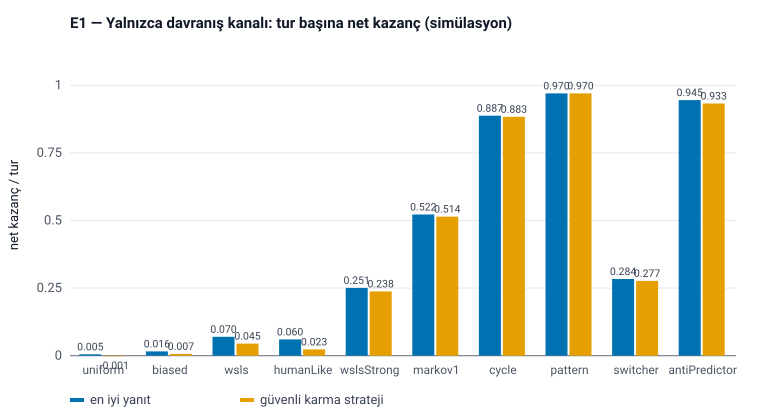
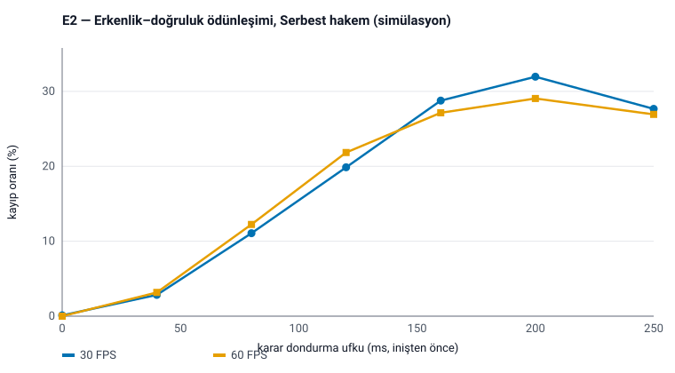
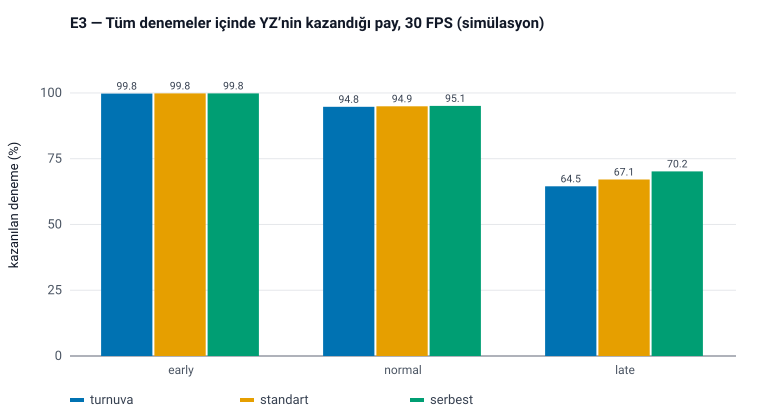
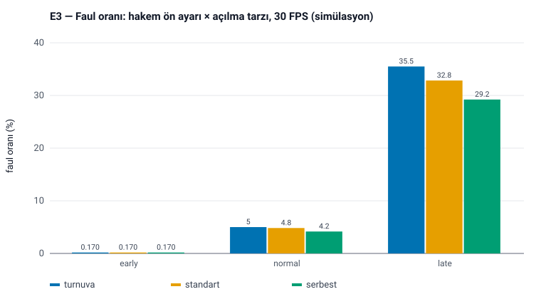
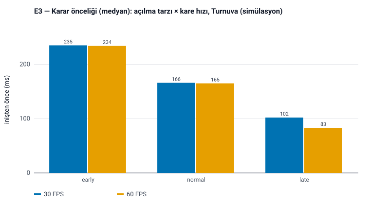
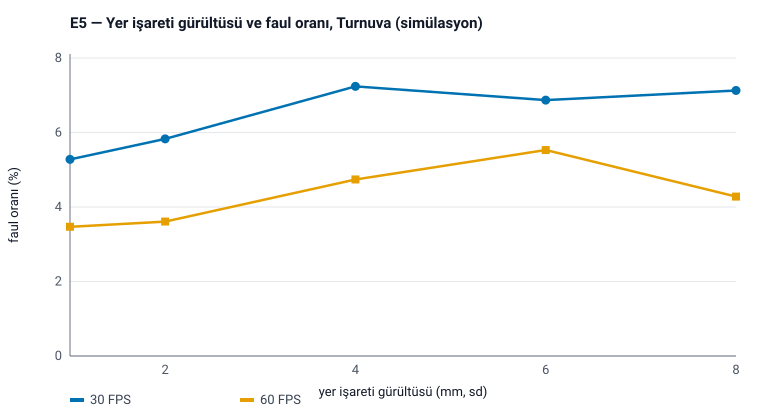
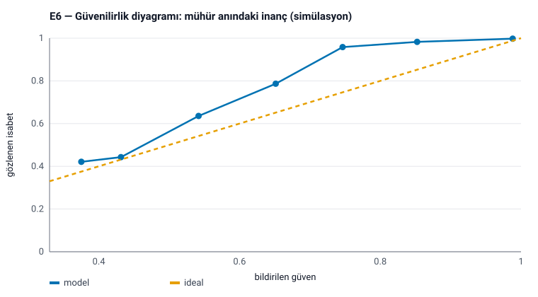
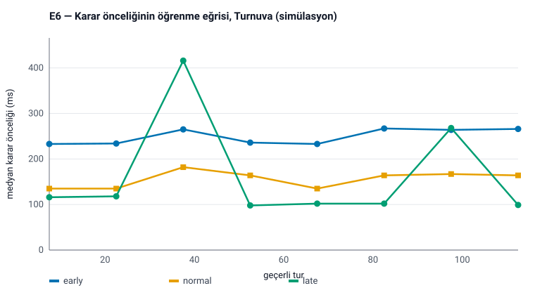
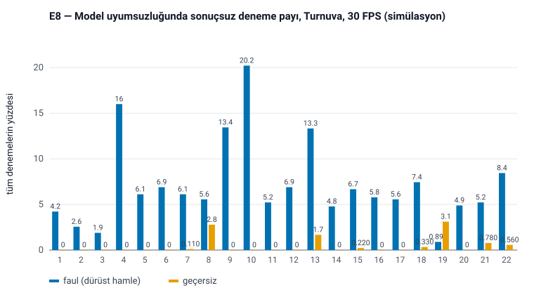

# 6. Deneyler ve Sonuçlar

> **Bu bölümdeki sayıların tamamı SİMÜLASYON sonucudur.** Gerçek insanlardan toplanmış hiçbir veri
> içermez. Sayılar, sistemin *belirtilen varsayımlar altında* nasıl davrandığını gösterir; gerçek oyunculara
> karşı başarımın kanıtı değildir. Gerçek insan doğrulaması için protokol Ek C'dedir. Neyin ölçülmediği
> Bölüm 6.9'un sonunda ayrıca listelenmiştir.

## 6.0 Düzenek, varsayımlar ve tabloların okunuşu

Deneyler `node experiments/run_all.mjs` ile yinelenebilir; bütün rastgelelik tohumludur, ham sayılar
`docs/results/*.json`, şekiller `docs/figures/*.svg` dosyalarındadır. Bu bölümdeki her sayı o dosyalardan
alınmıştır; dosyalar, Bölüm 5.1.8'deki v4.2 denetiminden sonraki v4.2.3 koduyla yeniden üretilmiştir. Sentetik
oyuncunun ürettiği kareler gerçek kamera kareleriyle aynı motordan geçer.

**Son kodla yeniden üretim.** Bu bölümün sayıları ilk olarak v4.0'ın koduyla üretilmişti. Sonraki üç sürümden
(v4.2.0–v4.2.2) ilk ikisi motorun davranışını değiştirdi (v4.2.2 motor koduna dokunmadı): 20 varsayılan değişti,
bir yenisi ve birkaç kural eklendi, hakem yönelimleri inişten sonra düzelten bir "mandal" kazandı (Ek A, Bölüm
5.1.8). Bu sürümlerin denetimi Turnuva güvencesinin kırıldığını ve dürüst bir Kâğıt'ın faul sayıldığını
bulmuş, düzeltmeler v4.2.3 olarak yapılmıştır. v4.2.3'te hakem yönelimleri her havadaki karede hesaplanıp
kareyle birlikte saklanır: bir grubun yönelimi, son $\max(340\ \text{ms},\ 3{,}5\ \text{kare aralığı})$ içinde o
grubun ham açıklığının en az 0,42 okunduğu revizyon karelerindekinin altına düşmez ve bu tutma, grubun
dedektörü yeniden çapalanınca biter. Havadaki kareler birbiriyle çelişirse tur faul sayılmaz, kendi açıklama
koduyla (`VOID_CONFLICT`) geçersizdir (Bölüm 5.1.8). Ardından bütün deneyler (E1–E8) ve bulanık sınama
v4.2.3 koduyla, aynı tohumlarla baştan koşulmuş; `docs/results/*.json` ile `docs/figures/*.svg` bu koşudan
yeniden üretilmiştir. Bu bölümdeki
her sayı, açıkça başka bir sürüme atfedilmedikçe, bu koşudandır. Yalnızca davranış kanalını kullanan E1'in
sonuç dosyası v4.0'dakiyle bayt bayt aynıdır; E2–E8'in sayıları v4.0'dakilerden farklıdır. Yorumu değişen
bulgularda v4.0'daki değer de verilmiştir (aynı dosyaların git geçmişindeki v4.0 sürümlerinden); bu farkların
hangi değişiklikten geldiği, aksi söylenmedikçe, ayrıştırılmamıştır. Sürümleri aynı tohumlarla karşılaştıran
ölçümler `experiments/version_compare.mjs` ile yinelenebilir.

**Tabloların okunuşu.** Tam sistem deneylerinde (E2–E5, E8) iki tür oran yan yana verilir ve farklı şeyleri
ölçer (Bölüm 4.10):

- **Koşullu sütunlar** — G / B / M (YZ galibiyeti / beraberlik / YZ mağlubiyeti) ve "Kayıp %" — paydası
  **geçerli turlar** olan oranlardır. Turnuva ön ayarında bir tur ancak hakem atışı, YZ'nin de okuduğu aynı
  havadaki karelerden kabul ederse geçerlidir; bu yüzden orada M = 0 **kuralın bir özelliğidir** (Teorem 1),
  iyi tahminin kanıtı değildir.
- **Koşulsuz sütunlar** — "Kazanılan deneme %" (YZ'nin kazandığı denemelerin bütün denemelere oranı) ve
  "Sonuçsuz deneme %" (faul + geçersiz + iptal, bütün denemelere oranı) — **sistemi** ölçer: dedektörün her
  hatası buraya düşer. İkisinin toplamının 100'den eksiği beraberlik ve mağlubiyetlerdir.
- "**Açık dürüst atışlarda faul**": yalnızca Taş atışları ile açılması inişten en az 110 ms önce başlamış
  atışlar üzerindeki faul oranı. Kuralın haklı olarak reddettiği geç açılmaları dışarıda bırakır; geriye
  kalan, dedektörün dürüst ve zamanında bir atışı faul sayma oranıdır.

Oranlar %95 Wilson aralığıyla verilir. Karar önceliği sütunlarındaki medyanlar geçerli turlar üzerindendir.

**Varsayımlar** (hiçbiri gerçek oyunculardan ölçülmemiştir):

1. **Parmak açılması en küçük sarsım profilini izler**; süre $\mathrm{LogN}(\ln 130\ \text{ms},\,0{,}35)$,
   $[50,400]$ ms'ye kırpılır. Dedektör de aynı yörünge ailesini varsayar; yani model ile "gerçek" aynı
   aileden gelir. Bu, sonuçları iyimser kılan en önemli varsayımdır.
2. **Açılma tarzları varsayımdır:** başlangıcın inişe göre önceliği erken açanlarda
   $\mathcal N(260,60^2)$, normalde $\mathcal N(170,60^2)$, geç açanlarda $\mathcal N(80,35^2)$ ms (en az 10 ms).
3. **Eklem gürültüsü bağımsız Gauss'tur:** dünya koordinatlarında eksen başına 2 mm, görüntüde 0,003 görüntü
   yüksekliği; kareden kareye bağımsızdır. Hareket bulanıklığı, sistematik sapma, kapanma (oklüzyon) ve
   izleyicinin zamansal ilintili hataları modellenmemiştir.
4. **Ritim:** dönem 520 ms (değişim katsayısı 0,05), inişin dönemdeki payı 0,38, genlik 1,6 avuç boyu;
   zaman damgası titreşimi ±2 ms; kare hızı tam 30 ya da 60'tır (kare düşmesi yalnızca E4'te).
5. **Davranış modelleri:** "humanLike" oyuncusu [ForderDyson2016] tablosunun kişiye göre ±%25 oynatılmış
   hâlini %15 rastgele sapmayla izler; "wsls" tabloyu aynen izler. Sentetik oyuncular **sömürüldüklerinde
   uyum sağlamaz**; gerçek insanlar sağlar (Bölüm 2.1).
6. **Jest etiketi** oturmuş şekillerde %5 olasılıkla eksiktir; Makas'ta yüzük/serçe artık açılması
   $\mathcal N(0{,}08,0{,}04^2)$'tir.
7. **Sentetik el, çekirdeğin tam tersidir:** açık parmaklar tam genliğe açılır ve simülatörün el modeli,
   kinematik modülünün varsayılan kalibrasyonla tam tersidir.

**E1–E7'deki sentetik oyuncu bu varsayımların hepsinde dedektörle eşleşmiştir**; sayıları sistemi en iyi
hâlinde gösterir. 1, 3 ve 7 numaralı varsayımları (ve Kâğıt'taki grup gecikmesini) bilerek bozan deney
E8'dir (Bölüm 6.8).

## 6.1 E1 — Yalnızca davranış kanalı

**Soru.** Kamera hiç kullanılmadan, yalnızca geçmiş hamlelerden ne kadar üstünlük elde edilebilir?
**Düzenek.** On sentetik oyuncu; her biri için 40 tohum × 300 tur = 12 000 tur. Her tohum **iki ayrı kapalı
döngüde** koşulur: birinde YZ dizi modelinin kestirimine deterministik *en iyi yanıtı*, diğerinde Bölüm
4.6'daki bütçeli *güvenli karma* stratejiyi oynar. Her koşuda model, o politikanın gerçekten oynadığı
hamlelerden öğrenir ve sentetik oyuncu o hamlelere tepki verir. (Önceki metinde "en iyi yanıt" sütunu,
güvenli stratejinin sürdüğü tek bir koşunun üzerinde hesaplanan politika-dışı bir karşı-olgusaldı: sonuca
koşullu oyuncular, en iyi yanıtın hiç üretmeyeceği durumlarda puanlanıyordu.) Bilgi kazancı en iyi yanıt
koşusundandır.

| Oyuncu | En iyi yanıt: kazanma % [%95 GA] | Berabere % | Kayıp % | Net/tur | Güvenli karma: kazanma % | Kayıp % | Net/tur | Bilgi kazancı (bit/tur) |
|---|---|---|---|---|---|---|---|---|
| uniform (rastgele) | 33,74 [32,90–34,59] | 33,02 | 33,23 | 0,0051 | 33,33 | 33,43 | −0,0010 | −0,0112 |
| biased (0,40/0,33/0,27) | 34,06 [33,22–34,91] | 33,45 | 32,49 | 0,0157 | 33,34 | 32,67 | 0,0067 | −0,0097 |
| wsls (literatür tablosu) | 36,42 [35,56–37,28] | 34,16 | 29,43 | 0,0699 | 35,21 | 30,74 | 0,0447 | 0,0056 |
| humanLike | 35,82 [34,96–36,68] | 34,40 | 29,78 | 0,0603 | 34,02 | 31,69 | 0,0232 | 0,0051 |
| wslsStrong (karikatür) | 46,11 [45,22–47,00] | 32,84 | 21,05 | 0,2506 | 45,38 | 21,61 | 0,2377 | 0,1562 |
| markov1 | 67,81 [66,97–68,64] | 16,57 | 15,62 | 0,5219 | 67,47 | 16,04 | 0,5142 | 0,3610 |
| cycle (%10 sapma) | 92,38 [91,90–92,84] | 3,95 | 3,67 | 0,8872 | 92,21 | 3,87 | 0,8834 | 1,1102 |
| pattern (5'li örüntü) | 98,00 [97,73–98,24] | 1,00 | 1,00 | 0,9700 | 98,00 | 1,00 | 0,9700 | 1,5095 |
| switcher (40 turda bir tarz) | 51,44 [50,55–52,34] | 25,48 | 23,08 | 0,2836 | 51,19 | 23,52 | 0,2767 | 0,2675 |
| antiPredictor | 96,20 [95,84–96,53] | 2,09 | 1,71 | 0,9449 | 95,51 | 2,25 | 0,9326 | 1,4226 |

**Yorum.** (i) Rastgele oyuncuya karşı kazanma oranı şansla uyumludur (%33,74; aralık %33,3'ü içerir) ve
net kazanç sıfıra yakındır (0,0051 ve −0,0010): Gözlem 1'in öngördüğü gibi davranış kanalı burada tasarım
gereği hiçbir şey kazanamaz. Bilgi kazancı hafifçe **negatiftir** (−0,011 bit/tur): öğrenen bir karışım,
öğrenecek bir şey olmadığında küçük bir bedel öder. (ii) Literatürdeki insan tablosuna karşı en iyi yanıtın
net kazancı tur başına 0,07'dir; bu, aynı tablo için Bölüm 2.1'de türetilen 0,13'lük tavanın ve gerçek
öğrencilere karşı bildirilen ≈0,12'nin [WangL2020] altındadır (farkın başlıca nedeni öğrenme maliyeti
olmalıdır). Bireysel farklı ve sapmalı "humanLike" oyuncuda 0,06'dır ve bilgi kazancı pratikte sıfırdır
(0,005 bit/tur). Bu satırlar önselin kendi kaynağına karşı sınanmasıdır (Bölüm 5.6) ve sentetik oyuncu uyum
sağlamaz; gerçek insanlarda daha düşük bir değer beklenmelidir. (iii) **Güvenli karma stratejinin bedeli
zayıf yapıda büyüktür.** "pattern" dışındaki her satırda güvenli strateji en iyi yanıttan az kazanır; güçlü
yapıda fark küçüktür (markov1: 0,522'ye karşı 0,514), insan benzeri oyuncularda ise kazancın önemli bir
bölümü gider (wsls: 0,070'ten 0,045'e; humanLike: 0,060'tan 0,023'e). Bu, Önerme 1'deki sınırın
bedelidir ve ürünle ilgili olan sütun budur: tam sistemde hareketten önce atılan davranış mührü güvenli
stratejinin hamlesidir. (iv) Yüksek satırlar (cycle, pattern, antiPredictor) insan davranışını değil, modelin
güçlü yapıyı öğrenebildiğini ve ikinci-tahmin döndürmelerinin çalıştığını gösterir. "antiPredictor" kendi
geçmişinin deterministik bir işlevidir; bu satır güvenlik mekanizmasını zorlamaz (onu zorlayan, Bölüm
4.6'daki kâhin testidir).

## 6.2 E2 — Erkenlik–doğruluk ödünleşimi

**Soru.** YZ kararını inişten ne kadar önce dondurmak zorunda kalırsa ne kaybeder?
**Düzenek.** **Serbest** ön ayarı, normal açanlar, "humanLike" davranış; dondurma ufku
$\Delta_{\text{don}}\in\{0,40,\dots,250\}$ ms; hücre başına 8 tohum × 120 = 960 deneme. İptal edilen
deneme yoktur; geçersiz deneme yalnızca 60 kare/s'nin iki hücresinde vardır (0 ve 80 ms'de ikişer; dördü de
havadaki karelerin çeliştiği turlardır, `VOID_CONFLICT`). Geri kalan sonuçsuz denemelerin tamamı fauldür.

**Neden Serbest?** Önceki metinde bu deney Turnuva altında yapılmıştı; o gerçeklemede dondurma ufku
Turnuva'da da etkiliydi. Bağımsız inceleme bunun bir kusur olduğunu göstermiştir: hakem eli son havadaki
kareye kadar okurken daha erken bakmayı bırakan bir YZ, yasal bir hamleye kaybeder ve kullanıcıya açık bir
ayar Turnuva güvencesini sessizce geçersiz kılar (Bölüm 5.1.6). Bugün dondurma ufku kaybetmeme öncelikli ön
ayarda **yok sayılır** (regresyon testi: 200 ms'lik dondurmayla Turnuva'da 220 denemede sıfır kayıp), bu
yüzden eğri ancak risk duyarlı bir ön ayarda ölçülebilir. Sorunun anlamı değişmemiştir.

| Kare/s | $\Delta_{\text{don}}$ (ms) | Geçerli $n$ | Kazanma % | Berabere % | Kayıp % [%95 GA] | Kazanılan deneme % | Sonuçsuz deneme % | Medyan öncelik (ms) | Oluşum oranı |
|---|---|---|---|---|---|---|---|---|---|
| 30 | 0 | 925 | 99,57 | 0,32 | 0,11 [0,02–0,61] | 95,94 | 3,65 | 167 | 0,435 |
| 30 | 40 | 915 | 96,07 | 1,09 | 2,84 [1,95–4,13] | 91,56 | 4,69 | 167 | 0,391 |
| 30 | 80 | 894 | 83,22 | 5,70 | 11,07 [9,18–13,30] | 77,50 | 6,88 | 201 | 0,314 |
| 30 | 120 | 911 | 66,74 | 13,39 | 19,87 [17,41–22,58] | 63,33 | 5,10 | 434 | 0,214 |
| 30 | 160 | 914 | 49,78 | 21,44 | 28,77 [25,93–31,79] | 47,40 | 4,79 | 464 | 0,101 |
| 30 | 200 | 920 | 46,20 | 21,85 | 31,96 [29,02–35,04] | 44,27 | 4,17 | 465 | 0,099 |
| 30 | 250 | 907 | 49,72 | 22,60 | 27,67 [24,86–30,67] | 46,98 | 5,52 | 466 | 0,128 |
| 60 | 0 | 925 | 99,89 | 0,11 | 0,00 [0,00–0,41] | 96,25 | 3,65 | 151 | 0,321 |
| 60 | 40 | 915 | 94,86 | 1,97 | 3,17 [2,22–4,51] | 90,42 | 4,69 | 166 | 0,299 |
| 60 | 80 | 923 | 82,34 | 5,42 | 12,24 [10,28–14,52] | 79,17 | 3,85 | 186 | 0,238 |
| 60 | 120 | 925 | 63,68 | 14,49 | 21,84 [19,29–24,61] | 61,35 | 3,65 | 481 | 0,148 |
| 60 | 160 | 925 | 51,14 | 21,73 | 27,14 [24,37–30,09] | 49,27 | 3,65 | 483 | 0,086 |
| 60 | 200 | 926 | 51,62 | 19,33 | 29,05 [26,22–32,06] | 49,79 | 3,54 | 483 | 0,103 |
| 60 | 250 | 932 | 54,08 | 18,99 | 26,93 [24,18–29,87] | 52,50 | 2,92 | 483 | 0,132 |

**Yorum.** Bu, tezin en önemli dürüstlük sonuçlarından biridir: **kinematik kanalın değeri son
karelerdedir.** Dondurma olmadan Serbest'te kayıp %0–0,1'dir. Son 40 ms'de revizyon yasaklandığında kayıp
oranı %2,8 (30 kare/s) ve %3,2'ye (60 kare/s), 80 ms'de %11–12'ye, 120 ms'de %20–22'ye çıkar; 160–250 ms'de
eğri düzleşir (kazanma %46–54, kayıp %27–32). Koşulsuz ölçü aynı şeyi söyler: kazanılan deneme payı %96'dan
160–250 ms'de %44,3–52,5'e düşer. Medyan önceliğin 167/151 ms'den 464–483 ms'ye sıçraması "daha erken karar"
değildir; turların en az yarısında değerlendirilen mührün uçuşun ilk karelerinde atıldığı ve sonra revize
edilemediği anlamına gelir (160–250 ms'de hareketten önceki davranış mührü geçerli turların yalnızca
%20–28'inde hiç değişmemiştir; geri kalanında mühür dondurmadan önce el okunarak değiştirilmiştir ve bu
kararların önceliğinin medyanı da 434–469 ms'dir). Simüle oyuncuların açılması ortalama 170 ms önce
başladığı için bu beklenen bir sonuçtur: hareket başlamadan önce hareketten bilgi alınamaz. 60 kare/s aynı
dondurma ufkunda 30 kare/s'den belirgin biçimde iyi değildir: 40–120 ms'de kaybı daha yüksektir (80 ms'de
%12,2'ye karşı %11,1; 40 ms'de %3,2'ye karşı %2,8), 160–250 ms'de 0,7–2,9 puan düşüktür; aralıklar her ufukta
örtüşür.

v4.0'da eğri 200–250 ms'de şans düzeyine iniyordu (kazanma %34–36, kayıp %37–39) ve kayıp oranı kazanma
oranını hafifçe aşıyordu: erken dondurulan karar davranış önselinden iyi değildi. Bugünkü kodda bu sonuç
yinelenmez; en uzun dondurmada da kazanma kaybın açıkça üzerindedir, ama dondurmasız düzeyin çok altındadır.
Farkın kaynağı ayrıştırılmamıştır. Gözlenen bir fark tablodaki oluşum oranıdır: değerlendirilen mühür
anındaki bu oran 200–250 ms'de 0,10–0,13'tür (v4.0'da 0,01–0,04), yani bugünkü kodda mühür anında ölçülen
açıklık daha büyüktür. Dondurma gerçek inişe değil öngörülen inişe göre uygulandığından, iniş öngörüsündeki
bir değişikliğin etkili olması mümkündür; bu sınanmamıştır.

## 6.3 E3 — Tam sistem: ön ayar × açılma tarzı × kare hızı

**Soru.** İki kanal ve hakem birlikte çalıştığında kayıp, sonuçsuz deneme payı ve karar önceliği nedir?
**Düzenek.** Üç ön ayar × üç tarz × iki kare hızı; hücre başına 8 tohum × 150 = 1200 deneme; "humanLike"
davranış. İptal edilen tur yoktur. Geçersiz tur yalnızca Serbest'in üç hücresinde vardır (normal açanlarda
60 kare/s'de 1, geç açanlarda 30 ve 60 kare/s'de 2 ve 7; hepsi havadaki karelerin çeliştiği turlardır,
`VOID_CONFLICT`); geri kalan sonuçsuz denemelerin tamamı fauldür. Taş atışları hiçbir hücrede faul
sayılmamıştır.

*Sonuçlar — koşullu (G / B / M, Kayıp) ve koşulsuz (Kazanılan, Sonuçsuz) oranlar:*

| Ön ayar | Tarz | Kare/s | Geçerli $n$ | G / B / M | Kayıp % [%95 GA] | Kazanılan deneme % [%95 GA] | Sonuçsuz deneme % [%95 GA] |
|---|---|---|---|---|---|---|---|
| Turnuva | erken | 30 | 1198 | 1197 / 1 / 0 | 0,00 [0,00–0,32] | 99,75 [99,27–99,91] | 0,17 [0,05–0,61] |
| Turnuva | erken | 60 | 1195 | 1191 / 4 / 0 | 0,00 [0,00–0,32] | 99,25 [98,58–99,60] | 0,42 [0,18–0,97] |
| Turnuva | normal | 30 | 1140 | 1137 / 3 / 0 | 0,00 [0,00–0,34] | 94,75 [93,34–95,88] | 5,00 [3,90–6,38] |
| Turnuva | normal | 60 | 1141 | 1136 / 5 / 0 | 0,00 [0,00–0,34] | 94,67 [93,25–95,80] | 4,92 [3,83–6,29] |
| Turnuva | geç | 30 | 774 | 774 / 0 / 0 | 0,00 [0,00–0,49] | 64,50 [61,75–67,16] | 35,50 [32,84–38,25] |
| Turnuva | geç | 60 | 843 | 841 / 2 / 0 | 0,00 [0,00–0,45] | 70,08 [67,43–72,61] | 29,75 [27,23–32,40] |
| Standart | erken | 30 | 1198 | 1198 / 0 / 0 | 0,00 [0,00–0,32] | 99,83 [99,39–99,95] | 0,17 [0,05–0,61] |
| Standart | erken | 60 | 1195 | 1193 / 2 / 0 | 0,00 [0,00–0,32] | 99,42 [98,80–99,72] | 0,42 [0,18–0,97] |
| Standart | normal | 30 | 1142 | 1139 / 3 / 0 | 0,00 [0,00–0,34] | 94,92 [93,52–96,02] | 4,83 [3,76–6,20] |
| Standart | normal | 60 | 1146 | 1144 / 2 / 0 | 0,00 [0,00–0,33] | 95,33 [93,99–96,39] | 4,50 [3,47–5,83] |
| Standart | geç | 30 | 806 | 805 / 1 / 0 | 0,00 [0,00–0,47] | 67,08 [64,37–69,68] | 32,83 [30,23–35,54] |
| Standart | geç | 60 | 846 | 842 / 4 / 0 | 0,00 [0,00–0,45] | 70,17 [67,52–72,69] | 29,50 [26,99–32,14] |
| Serbest | erken | 30 | 1198 | 1198 / 0 / 0 | 0,00 [0,00–0,32] | 99,83 [99,39–99,95] | 0,17 [0,05–0,61] |
| Serbest | erken | 60 | 1196 | 1194 / 2 / 0 | 0,00 [0,00–0,32] | 99,50 [98,91–99,77] | 0,33 [0,13–0,85] |
| Serbest | normal | 30 | 1150 | 1141 / 8 / 1 | 0,09 [0,02–0,49] | 95,08 [93,71–96,17] | 4,17 [3,17–5,45] |
| Serbest | normal | 60 | 1143 | 1131 / 10 / 2 | 0,17 [0,05–0,64] | 94,25 [92,79–95,43] | 4,75 [3,68–6,10] |
| Serbest | geç | 30 | 848 | 842 / 4 / 2 | 0,24 [0,06–0,86] | 70,17 [67,52–72,69] | 29,33 [26,83–31,97] |
| Serbest | geç | 60 | 881 | 873 / 8 / 0 | 0,00 [0,00–0,43] | 72,75 [70,16–75,19] | 26,58 [24,16–29,15] |

*Zamanlama ve faullerin dökümü:*

| Ön ayar | Tarz | Kare/s | Öncelik medyanı [Ç1–Ç3] (ms) | Kinematik öncelik medyanı (ms) | Tamamlanmaya öncelik (ms) | Oluşum oranı | Revize edilmeyen % | Faul %: Kâğıt / Makas atışları | Açık dürüst atışlarda faul % |
|---|---|---|---|---|---|---|---|---|---|
| Turnuva | erken | 30 | 235 [168–436] | 233 | 34 | 0,505 | 11,77 | 0,50 / 0,00 | 0,08 |
| Turnuva | erken | 60 | 234 [168–482] | 217 | 35 | 0,393 | 12,13 | 1,22 / 0,00 | 0,17 |
| Turnuva | normal | 30 | 166 [99–465] | 134 | 34 | 0,502 | 12,37 | 10,42 / 4,70 | 0,46 |
| Turnuva | normal | 60 | 165 [98–483] | 135 | 34 | 0,385 | 14,11 | 9,56 / 5,25 | 0,47 |
| Turnuva | geç | 30 | 102 [36–498] | 66 | 33 | 0,474 | 23,90 | 57,84 / 45,89 | 1,32 |
| Turnuva | geç | 60 | 83 [34–499] | 54 | 33 | 0,366 | 17,32 | 50,25 / 37,07 | 0,18 |
| Standart | erken | 30 | 236 [168–436] | 233 | 34 | 0,467 | 11,85 | 0,50 / 0,00 | 0,08 |
| Standart | erken | 60 | 235 [169–482] | 218 | 36 | 0,366 | 11,55 | 1,22 / 0,00 | 0,17 |
| Standart | normal | 30 | 166 [99–464] | 135 | 34 | 0,458 | 12,17 | 10,50 / 4,09 | 0,37 |
| Standart | normal | 60 | 165 [98–483] | 135 | 35 | 0,352 | 13,70 | 9,38 / 4,08 | 0,37 |
| Standart | geç | 30 | 99 [35–498] | 66 | 34 | 0,441 | 23,70 | 54,90 / 39,13 | 0,74 |
| Standart | geç | 60 | 82 [34–497] | 54 | 34 | 0,333 | 15,96 | 50,34 / 34,55 | 0,37 |
| Serbest | erken | 30 | 236 [169–435] | 233 | 34 | 0,432 | 11,69 | 0,50 / 0,00 | 0,08 |
| Serbest | erken | 60 | 237 [169–482] | 220 | 47 | 0,347 | 11,62 | 0,99 / 0,00 | 0,08 |
| Serbest | normal | 30 | 166 [99–464] | 134 | 35 | 0,416 | 13,30 | 8,17 / 4,30 | 0,19 |
| Serbest | normal | 60 | 165 [97–482] | 135 | 47 | 0,337 | 12,69 | 9,80 / 4,04 | 0,28 |
| Serbest | geç | 30 | 98 [35–467] | 67 | 34 | 0,378 | 19,22 | 51,08 / 33,66 | 1,47 |
| Serbest | geç | 60 | 82 [35–486] | 65 | 36 | 0,287 | 15,55 | 47,10 / 27,15 | 0,72 |

"Revize edilmeyen": hareketten önce atılan davranış mührünün hiç değişmediği geçerli turların payı.
"Kinematik öncelik": yalnızca değerlendirilen mührü el okunarak atılmış geçerli turlardaki öncelik.
"Tamamlanmaya öncelik" yalnızca Kâğıt ve Makas turlarında tanımlıdır.

**Yorum — kuralın sonucu.** Turnuva ön ayarının altı hücresinde toplam 6291 geçerli turda kayıp yoktur
(15 beraberlik; hücre başına üst güven sınırı %0,32–%0,49). Bütün mühürler ve oturum zincirleri
doğrulanmıştır. Bu satır Teorem 1'in simülasyondaki karşılığıdır; dedektörün ne kadar iyi olduğunu söylemez.

**Yorum — sistemin ölçüsü.**

1. **Bedel sonuçsuz denemelerdir ve geç açanlarda yüksektir.** Turnuva'da YZ, erken açanlara karşı
   denemelerin %99,25–99,75'ini, normal açanlara karşı %94,67–94,75'ini, geç açanlara karşı yalnızca
   **%64,5–70,1**'ini kazanır. Geri kalanın neredeyse tamamı fauldür: açılması inişten ortalama 80 ms önce
   başlayan bir oyuncunun yaklaşık üç atışından biri (30 kare/s'de %35,50 [32,84–38,25]) tekrarlanır. Böyle
   bir oyuncu için oyun deneyimi kabul edilemez olabilir.
2. **Fauller ağırlıkla geç açılmalardır; dedektörün açık atışlardaki hatası küçüktür — eşleşmiş
   simülatörde.** Normal açanlarda Kâğıt atışlarının yaklaşık %8–10'u (%8,17–10,50), Makas atışlarının %4–5'i
   (%4,04–5,25) faul sayılır (Kâğıt'ta iki grubun da açıldığının görülmesi gerekir). Açılması inişten en az
   110 ms önce başlamış dürüst atışlarda faul oranı ise normal açanlarda %0,19–0,47, geç açanlarda en çok
   %1,47'dir. Bu ayrım yalnızca sentetik el dedektörün varsayımlarına uyduğu sürece geçerlidir; uyumsuzlukta
   açık atışlardaki faulün %14,7'ye kadar çıktığı Bölüm 6.8'de gösterilmiştir.
3. **Ön ayarlar simülasyonda beklenenden az ayrışır.** Serbest ön ayarı 30 kare/s'de normal açanlarda
   sonuçsuz payı %5'ten %4,17'ye indirir (aralıklar örtüşür), geç açanlarda %35,5'ten %29,3'e. Karşılığında
   insana bıraktığı pay çok küçüktür: Serbest'te normal açanlarda 1150 ve 1143 geçerli turda 1 ve 2 kayıp
   (%0,09 [0,02–0,49] ve %0,17 [0,05–0,64]), geç açanlarda 30 kare/s'de 848 turda 2 kayıp (%0,24
   [0,06–0,86]); Standart'ın altı hücresinde hiç kayıp yoktur. Yani "sıkılık–faul" ödünleşimi vardır ama
   zayıftır: faullerin çoğu, her ön ayarın cezalandırdığı gerçekten geç açılmalardan gelir.
4. **Karar "hareket başlamadan önce" değil, çoğunlukla "hareket oluşurken" verilir.** Değerlendirilen mühür
   anında nihai şeklin ortalama en çok yarısı (30 kare/s'de 0,378–0,505; 60 kare/s'de 0,287–0,393) oluşmuştur
   ve mühür, şeklin tamamlanmasından medyanda yalnızca 33–36 ms (30 kare/s'de bir kare) öncedir (iki hücrede
   47 ms). Hareketten önceki mührün hiç değişmediği turların payı %12–24'tür; bunlar davranış kanalının
   haklı çıktığı turlardır.
5. **Karar önceliğini oyuncu belirler.** Medyan öncelik erken açanlarda 234–237, normalde 165–166, geç
   açanlarda 82–102 ms'dir; dağılım iki tepelidir (çeyrekler 34–499 ms): revize edilmeyen turlarda öncelik
   bütün uçuş süresidir (≈450–500 ms), revize edilenlerde son revizyonla iniş arasındaki birkaç karedir.
   İkinci tepeyi **kinematik öncelik** gösterir: el okunarak verilen kararların medyan önceliği erken
   açanlarda 217–233, normalde 134–135, geç açanlarda yalnızca **54–67 ms**'dir (30 kare/s'de 66–67 ms, yani
   iki kare). 30 kare/s'de öncelikler 33 ms'nin katlarına kümelenir (kare nicemlemesi).
6. **60 kare/s karar önceliğini artırmaz**; mühür anındaki oluşum oranını düşürür (daha az oluşmuş şekille
   karar) ve geç açanlarda sonuçsuz payı birkaç puan azaltır (Turnuva: %35,5'ten %29,8'e).

Bu deneyde ölçülen öncelikler **bilgi kümesi** öncelikleridir (kare zamanı). Duvar saati önceliği
simülasyonda tanımsızdır; gerçek bir kamerada kare → mühür gecikmesi kadar daha kısadır (Bölüm 4.10, 8.2).

## 6.4 E4 — Aldatmacalar, geç hamleler ve alternatif tur yapıları

**Düzenek.** On dört senaryo × iki ön ayar; hücre başına 6 tohum × 120 = 720 deneme. Aldatmaca: el havada
bir şekle açılır, inişten belirtilen süre önce başka bir şekle geçer (geçiş 90–120 ms). Son dört senaryo
bağımsız incelemeden sonra eklenmiştir: tek atış kipinde uzun bekleme, tek atış kipinde 60 kare/s,
incelemenin Turnuva'ya karşı kullandığı "önce Makas, sonra son anda yüzük ve serçe" saldırısı ve parmakları
tam açılmayan gevşek bir el.

*Turnuva:*

| Senaryo | Geçerli $n$ | G / B / M | Kayıp % [%95 GA] | Kazanılan deneme % | Sonuçsuz deneme % | Faul | Geçersiz | İptal | Öncelik medyanı (ms) | Tamamlanmaya öncelik (ms) |
|---|---|---|---|---|---|---|---|---|---|---|
| Aldatmaca Kâğıt→Taş, 150 ms önce | 650 | 650 / 0 / 0 | 0,00 [0,00–0,59] | 90,28 | 9,72 | 60 | 10 | 0 | 34 | — |
| Aldatmaca Makas→Kâğıt, 110 ms önce | 720 | 720 / 0 / 0 | 0,00 [0,00–0,53] | 100,00 | 0,00 | 0 | 0 | 0 | 67 | 33 |
| Aldatmaca Kâğıt→Makas, 150 ms önce | 720 | 665 / 55 / 0 | 0,00 [0,00–0,53] | 92,36 | 0,00 | 0 | 0 | 0 | 34 | −34 |
| Aldatmaca Makas→Kâğıt, çok geç (60 ms) | 485 | 485 / 0 / 0 | 0,00 [0,00–0,79] | 67,36 | 32,64 | 233 | 2 | 0 | 33 | 33 |
| Geç hamle: inişten 100 ms sonra açılma | 56 | 56 / 0 / 0 | 0,00 [0,00–6,42] | 7,78 | 92,22 | 664 | 0 | 0 | 502 | — |
| İzleme kayıpları (karelerin %15'i) | 576 | 575 / 1 / 0 | 0,00 [0,00–0,66] | 79,86 | 20,00 | 31 | 81 | 32 | 168 | 31 |
| Sol el | 681 | 681 / 0 / 0 | 0,00 [0,00–0,56] | 94,58 | 5,42 | 39 | 0 | 0 | 167 | 34 |
| Zayıf atış vuruşu (yumuşak iniş) | 677 | 676 / 1 / 0 | 0,00 [0,00–0,56] | 93,89 | 5,97 | 43 | 0 | 0 | 166 | 34 |
| İki hazırlık vuruşu | 681 | 681 / 0 / 0 | 0,00 [0,00–0,56] | 94,58 | 5,42 | 39 | 0 | 0 | 166 | 34 |
| Tek atış | 686 | 686 / 0 / 0 | 0,00 [0,00–0,56] | 95,28 | 4,72 | 34 | 0 | 0 | 134 | 34 |
| Tek atış, atıştan önce 3,5 s bekleme | 684 | 683 / 1 / 0 | 0,00 [0,00–0,56] | 94,86 | 5,00 | 36 | 0 | 0 | 134 | 34 |
| Tek atış, 60 kare/s | 670 | 669 / 1 / 0 | 0,00 [0,00–0,57] | 92,92 | 6,94 | 50 | 0 | 0 | 134 | 34 |
| Önce Makas, yüzük + serçe inişten 60 ms önce | 337 | 337 / 0 / 0 | 0,00 [0,00–1,13] | 46,81 | 53,19 | 378 | 5 | 0 | 33 | 34 |
| Gevşek açık el (parmaklar %75'te) | 672 | 671 / 1 / 0 | 0,00 [0,00–0,57] | 93,19 | 6,67 | 43 | 5 | 0 | 164 | 33 |

*Serbest:*

| Senaryo | Geçerli $n$ | G / B / M | Kayıp % [%95 GA] | Kazanılan deneme % | Sonuçsuz deneme % | Faul | Geçersiz | İptal | Öncelik medyanı (ms) | Tamamlanmaya öncelik (ms) |
|---|---|---|---|---|---|---|---|---|---|---|
| Aldatmaca Kâğıt→Taş, 150 ms önce | 650 | 650 / 0 / 0 | 0,00 [0,00–0,59] | 90,28 | 9,72 | 60 | 10 | 0 | 34 | — |
| Aldatmaca Makas→Kâğıt, 110 ms önce | 720 | 720 / 0 / 0 | 0,00 [0,00–0,53] | 100,00 | 0,00 | 0 | 0 | 0 | 67 | 33 |
| Aldatmaca Kâğıt→Makas, 150 ms önce | 720 | 668 / 52 / 0 | 0,00 [0,00–0,53] | 92,78 | 0,00 | 0 | 0 | 0 | 34 | −34 |
| Aldatmaca Makas→Kâğıt, çok geç (60 ms) | 563 | 562 / 0 / 1 | 0,18 [0,03–1,00] | 78,06 | 21,81 | 149 | 8 | 0 | 34 | 34 |
| Geç hamle: inişten 100 ms sonra açılma | 56 | 56 / 0 / 0 | 0,00 [0,00–6,42] | 7,78 | 92,22 | 664 | 0 | 0 | 502 | — |
| İzleme kayıpları (karelerin %15'i) | 571 | 569 / 1 / 1 | 0,18 [0,03–0,99] | 79,03 | 20,69 | 20 | 90 | 39 | 167 | 33 |
| Sol el | 691 | 689 / 1 / 1 | 0,14 [0,03–0,82] | 95,69 | 4,03 | 29 | 0 | 0 | 167 | 35 |
| Zayıf atış vuruşu (yumuşak iniş) | 686 | 684 / 2 / 0 | 0,00 [0,00–0,56] | 95,00 | 4,72 | 34 | 0 | 0 | 167 | 35 |
| İki hazırlık vuruşu | 696 | 691 / 2 / 3 | 0,43 [0,15–1,26] | 95,97 | 3,33 | 24 | 0 | 0 | 166 | 35 |
| Tek atış | 691 | 686 / 3 / 2 | 0,29 [0,08–1,05] | 95,28 | 4,03 | 29 | 0 | 0 | 134 | 34 |
| Tek atış, atıştan önce 3,5 s bekleme | 685 | 682 / 2 / 1 | 0,15 [0,03–0,82] | 94,72 | 4,86 | 35 | 0 | 0 | 134 | 34 |
| Tek atış, 60 kare/s | 691 | 682 / 4 / 5 | 0,72 [0,31–1,68] | 94,72 | 4,03 | 29 | 0 | 0 | 134 | 47 |
| Önce Makas, yüzük + serçe inişten 60 ms önce | 448 | 440 / 0 / 8 | 1,79 [0,91–3,48] | 61,11 | 37,78 | 234 | 38 | 0 | 34 | 35 |
| Gevşek açık el (parmaklar %75'te) | 680 | 670 / 9 / 1 | 0,15 [0,03–0,83] | 93,06 | 5,56 | 35 | 5 | 0 | 164 | 34 |

"Tamamlanmaya öncelik" Taş ile biten senaryolarda tanımsızdır; inişten sonra açılan geç hamlede de değeri
yoktur (—).

**Yorum.** (i) Havada tamamlanan aldatmacalar Turnuva'da kayıp üretmez, ancak karar önceliğini **bir iki
kareye** (33–67 ms) indirir: aldatan bir oyuncuya karşı YZ son ana kadar bekler. Kâğıt→Makas senaryosunda
mühür, medyanda şeklin tamamlanmasından bir kare sonra atılır (tamamlanmaya göre öncelik −34 ms); bu, D1'i
ihlal etmez (mühür inişten öncedir) ama "tamamlanmadan önce karar" ölçütünün aldatmaca altında sağlanmadığını gösterir. (ii)
Çok geç aldatmaca (Makas→Kâğıt, inişten 60 ms önce) yüksek faul üretir (Turnuva'da denemelerin %32,4'ü,
Serbest'te %20,7'si): son havadaki karede okunan açılma, inen şekille bağdaşmaz. Aynı senaryoda Turnuva'da 2,
Serbest'te 8 tur havadaki kareler çeliştiği için geçersizdir (`VOID_CONFLICT`); Kâğıt→Taş aldatmacasında bu
sayı iki ön ayarda da 10'dur (faul %8,3). Kâğıt→Makas aldatmacası ise artık hiç faul üretmez (v4.0'da
Turnuva'da denemelerin %29,2'si): bu senaryoda geçiş inişten yaklaşık 50 ms önce tamamlanır; havada açılıp
yeniden kapanan arka grup artık faule yol açmaz ve 720 turun hepsi geçerlidir. Ama turların %7,6'sı
berabere biter (Turnuva'da 665 galibiyet ve 55 beraberlik; Serbest'te 668 ve 52, %7,2): yeniden kapanan
arka grubun açık yönelimi, dedektörü yeniden çapalanana kadar bir kare daha tutulur; yasal küme o karede hem Kâğıt'ı hem
Makas'ı içerdiğinden YZ ikisine de kaybetmeyen Makas'ı seçer ve oyuncunun Makas'ına berabere kalır. Faulün
v4.0'a göre kalkmasının hangi değişiklikten geldiği ayrıştırılmamıştır. Faullerin türlere göre dökümü sonuç
dosyasında yoktur.
(iii) İnişten sonra açılan hamlelerin 720'de 664'ü (%92,22) faul sayılmıştır; 56'sını
hakem kaçırmıştır (bunlar geçerli sayılmış ve YZ 56'sını da kazanmıştır). v4.0'da kaçırılan 4 atıştı
(%0,56); hakemin v4.2'de değişen kural ve ayarlarından hangisinin buna yol açtığı ayrıştırılmamıştır. (iv) **Kare
kayıpları kayıp üretmez, tur verimini düşürür:** karelerin taban olarak %15'i düştüğünde 720 denemenin 576'sı
(%80) geçerli bir tura dönüşür; 81'i EL YOK ile geçersiz, 32'si iptal, 31'i fauldür. v4.0'da yalnızca 254'ü
(%35) geçerliydi (294 EL YOK, 136 iptal). Fark v4.0 ile v4.2.3 arasındaki değişikliklerden gelir; bunların
arasında kısa izleme boşluklarını ve son havadaki karenin yaşını daha hoşgörülü değerlendiren v4.2.0 ayar ve
kuralları vardır (Ek A, Bölüm 5.1.8), ama hangisinin ne kadar katkı yaptığı ayrıştırılmamıştır. Tazelik
kuralı (Bölüm 4.4) kanıt bayatsa yine hüküm vermez; yalnızca v4.2.0'dan beri bayatlık eşiği daha geniştir
(Ek A). Bu, gerçek bir izleyicinin hızlı vuruşlarda eli ne sıklıkla kaybettiğine bağlı olarak ürünün
kullanılabilirliğini belirleyebilecek bir sayıdır ve gerçekte ölçülmemiştir. (v) **Tek atış kipi** inceleme
sonrasında hazırlık vuruşlu kiplerle aynı düzeydedir: sonuçsuz pay %4,7; atıştan önce 3,5 s beklendiğinde
%5,0; 60 kare/s'de %6,9; hiçbir deneme iptal edilmemiş ya da hükümsüz kalmamıştır. Bu kipte medyan öncelik
(134 ms) kinematik önceliğin medyanına (132 ms) yakındır; oyuncunun bekleme süresi yalnızca davranış mührünün
hiç revize edilmediği turların önceliğine eklenir. (vi) **"Önce Makas, sonra yüzük ve serçe" saldırısı**
Turnuva'da tek bir kayıp üretmez; bedeli faullerdir: 720 denemenin 378'i (%52,5) geç hamle sayılır, çünkü
arka grubun açılması havada ölçülebilir hâle gelmemiştir; 5 tur da havadaki kareler çeliştiği için
geçersizdir. Serbest'te aynı saldırı insana gerçek bir pay bırakır: 448 geçerli turda 8 kayıp (%1,79
[0,91–3,48]; ayrıca 234 faul ve çelişen kareler yüzünden 38 geçersiz tur). (vii) Parmakları varsayılan
açık okumanın %75'inde kalan gevşek bir el okunabilir: 720 denemenin 5'i BELİRSİZ ŞEKİL ile geçersizdir, sonuçsuz pay %6,7'dir.
Serbest ön ayarında on dört senaryonun toplam 8548 geçerli turunda 23 kayıp vardır (Makas-sonra-yüzük/serçe
8, tek atış 60 kare/s 5, iki hazırlık vuruşu 3, tek atış 2; çok geç aldatmaca, izleme kayıpları, sol el,
uzun bekleme ve gevşek el 1'er; v4.0'da 7863 turda 9); Turnuva'da 8295 geçerli turda sıfır.

## 6.5 E5 — Algılayıcı gürültüsü

**Düzenek.** Turnuva, normal açanlar; eklem gürültüsü 1–8 mm (eksen başına SS; yalnızca dünya
koordinatlarında); hücre başına 720 deneme. 907 geçersiz turun 895'i BELİRSİZ ŞEKİL ile geçersizdir; geri
kalan 12'si havadaki karelerin çeliştiği turlardır (`VOID_CONFLICT`). İzleme kaybıyla (EL YOK) geçersiz sayılan
ya da iptal edilen tur yoktur.

| Gürültü (mm) | Kare/s | Geçerli $n$ | G / B / M | Kayıp % [%95 GA] | Kazanılan deneme % | Sonuçsuz deneme % | Faul (deneme %) | Geçersiz (deneme %) | Öncelik medyanı (ms) | Revize edilmeyen % |
|---|---|---|---|---|---|---|---|---|---|---|
| 1 | 30 | 682 | 682 / 0 / 0 | 0,00 [0,00–0,56] | 94,72 | 5,28 | 5,28 | 0,00 | 164 | 10,85 |
| 1 | 60 | 695 | 693 / 2 / 0 | 0,00 [0,00–0,55] | 96,25 | 3,47 | 3,47 | 0,00 | 150 | 10,79 |
| 2 | 30 | 678 | 678 / 0 / 0 | 0,00 [0,00–0,56] | 94,17 | 5,83 | 5,83 | 0,00 | 164 | 12,09 |
| 2 | 60 | 694 | 692 / 2 / 0 | 0,00 [0,00–0,55] | 96,11 | 3,61 | 3,61 | 0,00 | 150 | 10,66 |
| 4 | 30 | 666 | 665 / 1 / 0 | 0,00 [0,00–0,57] | 92,36 | 7,50 | 7,22 | 0,28 | 166 | 11,41 |
| 4 | 60 | 684 | 681 / 3 / 0 | 0,00 [0,00–0,56] | 94,58 | 5,00 | 4,72 | 0,28 | 150 | 13,16 |
| 6 | 30 | 556 | 550 / 6 / 0 | 0,00 [0,00–0,69] | 76,39 | 22,78 | 5,69 | 17,08 | 168 | 10,97 |
| 6 | 60 | 495 | 494 / 1 / 0 | 0,00 [0,00–0,77] | 68,61 | 31,25 | 4,03 | 27,22 | 169 | 11,11 |
| 8 | 30 | 404 | 399 / 5 / 0 | 0,00 [0,00–0,94] | 55,42 | 43,89 | 4,31 | 39,58 | 200 | 8,42 |
| 8 | 60 | 403 | 397 / 6 / 0 | 0,00 [0,00–0,94] | 55,14 | 44,03 | 2,50 | 41,53 | 184 | 9,68 |

**Yorum.** 4 mm'ye kadar sistem bozulmadan çalışır (sonuçsuz pay %3,5–7,5; 4 mm'deki dört geçersiz tur dışında
tamamı faul). 6 mm'den itibaren **çöker, ama sessizce değil**: hakem denemelerin %17–27'sini (6 mm) ve
%40–42'sini (8 mm), çoğunu "şekil tanınmadı" diye, geçersiz sayar; YZ'nin kazandığı deneme payı 4 mm'ye kadarki
%92–96'dan 8 mm'de %55'e düşer. Geçerli kalan turlardaki "%98–100 kazanma" ise **yanıltıcıdır** ve
sağlamlık kanıtı sayılmamalıdır: bu oran kuralın sonucudur. 8 mm'de de mühürlerin çoğu el okunarak revize
edilir (hiç revize edilmeyenler %8,42 ve %9,68; medyan öncelik 184–200 ms); v4.0'da 60 kare/s'de mühürlerin
%41'i hiç revize edilmemiş ve medyan öncelik neredeyse bütün uçuş süresine (485 ms) çıkmıştı, bu bugünkü
kodda yinelenmez. Ama geçerli turların yalnızca hakemin tanıyabildiği şekillerden oluşması bir **seçilim
yanlılığı**dır; bu, "geçerli turlarda kazanma oranı"nın tek başına raporlanmasının neden yetersiz olduğunu
gösterir. Koşulsuz sütunlar her zaman birlikte verilmelidir.

Varsayılan 2 mm değeri bir ölçüm değildir. Üreticinin model kartı iki boyutta avuç boyunun %10'u dolayında
ortalama mutlak hata bildirir [MediaPipeHandCard2021]; bu, işaretleme farklarını da içeren bir mutlak hata
olup kareden kareye titreşimi vermez, ancak gerçek gürültünün 2 mm'den büyük olabileceğine işaret eder.
Gerçek sistemin E5'in hangi satırında çalıştığı bilinmemektedir (Bölüm 8.2).

## 6.6 E6 — Kalibrasyon ve öğrenme eğrileri

**Kalibrasyon.** Turnuva, normal açanlar, 30 kare/s; 8 tohum × 300 deneme; değerlendirilen mühür anındaki
sonsal gerçek hamleyle karşılaştırılır ($n=2270$).

| İsabet | Brier | Log-kayıp (bit) | Bilgi kazancı (bit/tur) | ECE |
|---|---|---|---|---|
| %76,83 | 0,2897 | 0,7003 | 0,8846 | 0,0558 |

| Güven kutusu | $n$ | Ortalama güven | Gözlenen isabet |
|---|---|---|---|
| 0,3–0,4 | 508 | 0,375 | 0,421 |
| 0,4–0,5 | 228 | 0,431 | 0,443 |
| 0,5–0,6 | 184 | 0,542 | 0,636 |
| 0,6–0,7 | 122 | 0,651 | 0,787 |
| 0,7–0,8 | 168 | 0,746 | 0,958 |
| 0,8–0,9 | 174 | 0,852 | 0,983 |
| 0,9–1,0 | 886 | 0,988 | 0,998 |

**Yorum.** Sonsal bilgilendiricidir (şansa göre 0,88 bit/tur; tavan 1,58) ama **iyi kalibre değildir**:
her kutuda gözlenen isabet bildirilen güvenin üzerindedir; orta kutularda fark büyüktür (0,746 güvene karşı
0,958 isabet). Model sistematik olarak **az güvenlidir**; ECE 0,056'dır. Ayrıca mühür anındaki en olası
sınıf turların yalnızca %76,8'inde doğrudur, oysa aynı düzenekte geçerli turlarda kazanma oranı %100'e
yakındır. Bunun açıklaması kararın sonsalın tepe sınıfına değil **hakemin yasal kümesine** dayanmasıdır
(Lemma 1: yasal sınıflardan biri dışlandığında kaybetmeyen bir hamle vardır) ve mühür ayakta kaldığı sürece
sonsalın sonraki keskinleşmesinin kaydedilmemesidir. Arayüzde gösterilen olasılıklar bu nedenle "kesin
sayılar" olarak değil, kalibrasyon hatasıyla birlikte sunulmalıdır.

**Öğrenme.** Her tarz için 12 tohum; geçerli turlar 15'lik bloklara ayrılır.

| Tarz | Blok medyanı: karar önceliği (ms), 1.–8. blok | Öğrenilen ön başlangıç önceliği (ms) | Simülasyondaki gerçek ortalama (ms) |
|---|---|---|---|
| erken | 233, 234, 265, 236, 233, 267, 264, 266 | 280 | 260 |
| normal | 135, 135, 182, 164, 135, 164, 167, 164 | 196 | 170 |
| geç | 116, 118, 416, 98, 102, 102, 268, 99 | 125 | 80 |

**Yorum.** (i) Oyuncuya özgü önsel öğrenilir (öğrenme öncesi 170 ms'den 280 / 196 / 125 ms'ye), ancak
öğrenilen değer simülasyondaki gerçek ortalamanın **20–45 ms üzerindedir**. İki olası neden vardır ve
ayrıştırılmamıştır: başlangıç ölçümünün yanlılığı ve seçilim (yalnızca geçerli turlardan öğrenilir; en geç
başlayan açılmalar faul olduğu için öğrenme kümesine girmez — geç açanlarda etki en büyüktür). (ii) **Karar
önceliği öğrenmeyle az büyür:** normal açanlarda ilk iki bloktaki ≈135 ms'den sonraki bloklarda çoğunlukla
164–167 ms'ye (yaklaşık bir kare; üçüncü blokta 182, beşinci blokta yine 135 ms), erken açanlarda ≈233'ten
≈265 ms'ye; geç açanlarda bir eğilim yoktur. Geç açanlardaki 416 ve 268 ms'lik blok medyanları öğrenme değil,
iki tepeli dağılımda medyanın üst tepeye ya da iki tepenin arasına kaymasıdır (E3'te bu tarzda, Turnuva'da,
kinematik önceliğin medyanı 54–66 ms, bütün geçerli turların üst çeyreği 498–499 ms'dir).
Dolayısıyla "tur sayısı arttıkça daha erken tanır" beklentisi simülasyonda yalnızca zayıf biçimde
doğrulanmıştır; önceliği esas olarak oyuncunun parmaklarını ne zaman açmaya başladığı belirler.

## 6.7 E7 — İki kanalın ayrıştırılması

**Düzenek.** Turnuva, normal açanlar, 30 kare/s, "humanLike"; 8 tohum × 300 deneme. Aynı geçerli turlarda
($n=2276$) iki karar karşılaştırılır: hareket başlamadan atılan davranış mührü (karşı-olgusal) ve
değerlendirilen mühür.

| Karar | Kazanma % [%95 GA] | Berabere % | Kayıp % |
|---|---|---|---|
| Yalnızca davranış kanalı (hareketten önceki mühür) | 37,79 [35,82–39,80] | 34,71 | 27,50 |
| Davranış + kinematik (değerlendirilen mühür) | 99,96 [99,75–99,99] | 0,04 | 0,00 |

Davranış mührü geçerli turların %13,40'ında hiç revize edilmemiştir.

**Yorum.** Sistemin başarımının neredeyse tamamı **kinematik kanaldan** gelir. Davranış kanalı tek başına
şansın üzerindedir (aralık %33,3'ü dışlar; net ≈ +0,10/tur), ama "yenilmezlik"le ilgisi yoktur. Bu değer
E1'deki "humanLike" satırından (en iyi yanıtla 0,06, davranış mührünün gerçekte izlediği güvenli stratejiyle
0,02) yüksektir; olası bir neden E5'te görülen seçilimin hafif bir biçimidir: faul sayılan turlar yalnızca
Kâğıt/Makas atışlarıdır, bu yüzden geçerli turlarda Taş fazla temsil edilir ve davranış kanalı fazladan bir
sıklık ipucu kazanır. Bu etki ayrıştırılmamıştır. Literatürle karşılaştırma: gerçek öğrencilere karşı
bildirilen Markov topluluğu kazancı tur başına ≈ +0,12'dir [WangL2020]; insanlara karşı uyarlanır botların
300 turdaki ortalama galibiyet farkı kabaca −50 ile +50 arasındadır [BrockbankVul2024]. E7'deki davranış
değeri bu aralıkla uyumlu olmakla birlikte, uyum sağlamayan sentetik bir oyuncuya ve seçilmiş turlara
dayandığı için iyimser bir üst değer olarak okunmalıdır.

## 6.8 E8 — Model uyumsuzluğuna dayanıklılık

**Soru.** E1–E7'nin sayıları, sentetik oyuncunun dedektörün kendi varsayımlarından üretilmiş olmasına ne
kadar bağlıdır? Bağımsız incelemenin temel eleştirilerinden biri buydu: simülatör dedektörle aynı yörünge
ailesini, aynı önsel merkezlerini, tam genliği, bağımsız Gauss gürültüsünü ve çekirdeğin tam tersi olan bir
el modelini kullanıyor; sonuçlar modeli kendisine karşı ölçüyordu ve bunun ne kadar iyimser olduğu
nicelenmemişti.

**Düzenek.** Dürüst, normal açan, "humanLike" davranışlı oyuncu; koşul başına 6 tohum × 150 = 900 deneme.
İlk satır eşleşmiş tabandır; sonraki her satır **tek bir varsayımı** bozar, son satır birkaçını hafifçe
birlikte bozar. Koşullar üç blokta koşulur: Turnuva 30 kare/s, Turnuva 60 kare/s ve Serbest 30 kare/s.
Bozulmalar şunlardır:

- *Açılma profili* (2–4): en küçük sarsım yerine doğrusal; üstel (ani başlangıç, yavaş bitiş); kübik (yavaş
  başlangıç, geç hızlanma).
- *Parmak eşzamansızlığı* (5–6): her parmağın kendi başlangıç kayması (SS 30 ve 60 ms; varsayılan 5 ms).
- *Açık el genliği* (7–8): açılan parmakların son açıklığı 1 yerine $\mathcal N(0{,}80;\,0{,}10)$ ve
  $\mathcal N(0{,}65;\,0{,}10)$.
- *Yavaş açılma* (9): medyan süre 130 yerine 250 ms.
- *Yüzük/serçe gecikmesi* (10): Kâğıt'ta arka grup ön gruptan $\mathcal N(15,20)$ yerine
  $\mathcal N(100,50)$ ms sonra başlar.
- *Gürültü yapısı* (11–15): kareler arası ilintili (AR(1), $\rho=0{,}8$); avuç hızıyla büyüyen (SS, avuç
  hızı $v$ AB/s iken $1+g\cdot\min(1{,}5;\,v/8)$ ile çarpılır; $g=2$ ve $4$); karelerin %5 ve %15'inde bir
  parmak ucunun sıçraması (3 cm SS).
- *Geometri* (16–17): görünen el boyutunun kareden kareye %10 oynaması; vuruş boyunca 25° bilek eğimi.
- *Eylemsizlikle gevşeme* (18–19): kapalı parmakların vuruş hızıyla aralanması (bütün vuruşlarda 0,25;
  yalnızca atış vuruşunda 0,20).
- *Farklı kurulu bir el* (20–21): gerçek yumruk/açık bükülme açıları çekirdeğin varsaydığı ≈215°/≈25° yerine
  180°/45° ve 160°/60°.
- *Birleşik hafif uyumsuzluk* (22): doğrusal profil, 30 ms eşzamansızlık, 0,80 genlik, $\rho=0{,}8$, hıza
  bağlı gürültü ($g=2$) ve %5 aykırı değer birlikte.

**Turnuva, 30 kare/s** (faul ve geçersiz, **bütün denemelerin** yüzdesidir; G / B / M geçerli turların
yüzdesidir; hiçbir satırda iptal yoktur):

| # | Koşul | Geçerli % | G / B / M (geçerli turların %'si) | Faul (deneme %) | Geçersiz (deneme %) | Açık dürüst atışlarda faul % | Medyan öncelik (ms) |
|---|---|---|---|---|---|---|---|
| 1 | Eşleşmiş taban (en küçük sarsım, bağımsız gürültü) | 95,78 | 99,65 / 0,35 / 0,00 | 4,22 | 0,00 | 0,00 | 167 |
| 2 | Açılma profili: doğrusal | 97,44 | 99,89 / 0,11 / 0,00 | 2,56 | 0,00 | 0,00 | 167 |
| 3 | Açılma profili: üstel (ani başlangıç) | 98,11 | 99,43 / 0,57 / 0,00 | 1,89 | 0,00 | 0,00 | 199 |
| 4 | Açılma profili: kübik (yavaş başlangıç) | 84,00 | 99,87 / 0,13 / 0,00 | 16,00 | 0,00 | 7,72 | 136 |
| 5 | Parmak eşzamansızlığı, SS 30 ms | 93,89 | 100,00 / 0,00 / 0,00 | 6,11 | 0,00 | 0,98 | 168 |
| 6 | Parmak eşzamansızlığı, SS 60 ms | 93,11 | 100,00 / 0,00 / 0,00 | 6,89 | 0,00 | 2,50 | 199 |
| 7 | Açık el genliği $\mathcal N(0{,}80,\,0{,}10)$ | 93,78 | 99,41 / 0,59 / 0,00 | 6,11 | 0,11 | 0,87 | 165 |
| 8 | Açık el genliği $\mathcal N(0{,}65,\,0{,}10)$ | 91,67 | 99,52 / 0,48 / 0,00 | 5,56 | 2,78 | 1,09 | 166 |
| 9 | Yavaş açılma (medyan 250 ms) | 86,56 | 99,87 / 0,13 / 0,00 | 13,44 | 0,00 | 6,14 | 135 |
| 10 | Yüzük/serçe gecikmesi $\mathcal N(100,\,50)$ ms | 79,78 | 100,00 / 0,00 / 0,00 | 20,22 | 0,00 | 14,73 | 167 |
| 11 | İlintili gürültü, AR(1), $\rho=0{,}8$ | 94,78 | 100,00 / 0,00 / 0,00 | 5,22 | 0,00 | 0,62 | 166 |
| 12 | Hıza bağlı gürültü, $\times(1+2v/8)$ | 93,11 | 99,88 / 0,12 / 0,00 | 6,89 | 0,00 | 1,37 | 165 |
| 13 | Hıza bağlı gürültü, $\times(1+4v/8)$ | 85,00 | 99,35 / 0,65 / 0,00 | 13,33 | 1,67 | 7,44 | 69 |
| 14 | Parmak ucu aykırı değerleri, karelerin %5'i (3 cm) | 95,22 | 100,00 / 0,00 / 0,00 | 4,78 | 0,00 | 0,49 | 166 |
| 15 | Parmak ucu aykırı değerleri, karelerin %15'i (3 cm) | 93,11 | 100,00 / 0,00 / 0,00 | 6,67 | 0,22 | 1,37 | 165 |
| 16 | Görünen el boyutu titreşimi, %10 | 94,22 | 100,00 / 0,00 / 0,00 | 5,78 | 0,00 | 0,50 | 166 |
| 17 | Vuruş boyunca 25° bilek eğimi | 94,44 | 99,76 / 0,24 / 0,00 | 5,56 | 0,00 | 0,61 | 167 |
| 18 | Eylemsizlikle parmak gevşemesi 0,25 | 92,22 | 100,00 / 0,00 / 0,00 | 7,44 | 0,33 | 1,15 | 135 |
| 19 | Eylemsizlikle gevşeme 0,20, yalnızca atış vuruşunda | 96,00 | 98,50 / 1,50 / 0,00 | 0,89 | 3,11 | 0,00 | 69 |
| 20 | El: yumruk 180° / açık 45° | 95,11 | 99,88 / 0,12 / 0,00 | 4,89 | 0,00 | 0,25 | 167 |
| 21 | El: yumruk 160° / açık 60° | 94,00 | 99,76 / 0,24 / 0,00 | 5,22 | 0,78 | 0,85 | 166 |
| 22 | Birleşik hafif uyumsuzluk | 91,00 | 98,90 / 1,10 / 0,00 | 8,44 | 0,56 | 3,43 | 135 |

Şekildeki çubuk numaraları tablonun satır numaralarıdır.

**Turnuva 60 kare/s ve Serbest 30 kare/s** (satır numaraları yukarıdaki tablonun koşullarıdır; hiçbir
satırda iptal yoktur):

| # | Turnuva 60 kare/s: faul % | geçersiz % | açık dürüst faul % | kayıp (sayı) | öncelik (ms) | Serbest 30 kare/s: faul % | geçersiz % | G / B / M (geçerli turların %'si) | kayıp (sayı / geçerli) | öncelik (ms) |
|---|---|---|---|---|---|---|---|---|---|---|
| 1 | 3,78 | 0,00 | 0,25 | 0 | 151 | 3,11 | 0,00 | 98,74 / 0,69 / 0,57 | 5 / 872 | 168 |
| 2 | 1,67 | 0,00 | 0,00 | 0 | 166 | 1,89 | 0,00 | 99,21 / 0,68 / 0,11 | 1 / 883 | 170 |
| 3 | 0,78 | 0,00 | 0,00 | 0 | 183 | 1,33 | 0,00 | 99,21 / 0,79 / 0,00 | 0 / 888 | 200 |
| 4 | 10,44 | 0,11 | 4,69 | 0 | 135 | 11,56 | 0,22 | 98,87 / 0,88 / 0,25 | 2 / 794 | 135 |
| 5 | 4,89 | 0,00 | 0,50 | 0 | 167 | 4,67 | 0,00 | 99,65 / 0,23 / 0,12 | 1 / 858 | 169 |
| 6 | 6,11 | 0,00 | 1,62 | 0 | 183 | 4,56 | 0,11 | 99,30 / 0,58 / 0,12 | 1 / 858 | 200 |
| 7 | 4,78 | 0,44 | 0,25 | 0 | 152 | 3,78 | 0,33 | 99,30 / 0,58 / 0,12 | 1 / 863 | 165 |
| 8 | 5,56 | 2,33 | 0,50 | 0 | 150 | 5,22 | 2,78 | 98,79 / 0,85 / 0,36 | 3 / 828 | 167 |
| 9 | 10,89 | 0,11 | 3,35 | 0 | 136 | 10,67 | 0,11 | 98,88 / 0,75 / 0,37 | 3 / 803 | 135 |
| 10 | 15,67 | 0,00 | 11,66 | 0 | 152 | 16,11 | 0,22 | 99,34 / 0,13 / 0,53 | 4 / 753 | 167 |
| 11 | 4,44 | 0,00 | 0,24 | 0 | 151 | 4,00 | 0,00 | 99,65 / 0,23 / 0,12 | 1 / 864 | 168 |
| 12 | 6,11 | 0,00 | 0,99 | 0 | 134 | 5,56 | 0,11 | 98,70 / 1,06 / 0,24 | 2 / 849 | 136 |
| 13 | 10,11 | 1,00 | 4,52 | 0 | 52 | 6,22 | 5,22 | 95,11 / 3,76 / 1,13 | 9 / 797 | 70 |
| 14 | 4,22 | 0,11 | 0,25 | 0 | 151 | 4,67 | 0,11 | 99,88 / 0,12 / 0,00 | 0 / 857 | 167 |
| 15 | 4,33 | 1,00 | 0,49 | 0 | 166 | 5,56 | 0,44 | 99,29 / 0,35 / 0,35 | 3 / 846 | 166 |
| 16 | 4,44 | 0,00 | 0,13 | 0 | 150 | 4,89 | 0,00 | 99,42 / 0,35 / 0,23 | 2 / 856 | 167 |
| 17 | 4,78 | 0,00 | 0,25 | 0 | 151 | 3,44 | 0,00 | 99,42 / 0,35 / 0,23 | 2 / 869 | 167 |
| 18 | 4,00 | 2,11 | 0,75 | 0 | 116 | 1,56 | 3,78 | 99,18 / 0,12 / 0,70 | 6 / 852 | 97 |
| 19 | 0,11 | 5,11 | 0,00 | 0 | 51 | 0,00 | 2,89 | 96,68 / 2,97 / 0,34 | 3 / 874 | 66 |
| 20 | 3,89 | 0,00 | 0,12 | 0 | 150 | 3,33 | 0,00 | 98,39 / 1,15 / 0,46 | 4 / 870 | 167 |
| 21 | 6,11 | 0,56 | 0,38 | 0 | 150 | 4,56 | 0,78 | 98,83 / 0,94 / 0,23 | 2 / 852 | 165 |
| 22 | 5,67 | 0,56 | 1,14 | 0 | 132 | 4,44 | 1,11 | 94,35 / 4,82 / 0,82 | 7 / 850 | 166 |

**Yorum.**

1. **Turnuva'da kayıp her koşulda sıfırdır — ve bu hiçbir şey kanıtlamaz.** İki Turnuva bloğunun 44
   satırında toplam 36 865 geçerli turda tek bir kayıp yoktur. Bu, kuralın yapısından gelir (Teorem 1):
   model ne kadar yanlış olursa olsun, teoremin koşulları altında (Bölüm 4.7) geçerli bir turda kayıp olamaz. Uyumsuzluğun etkisi G / B / M
   sütununda **görünmez**; yalnızca koşullu oranlara bakan biri sistemi her koşulda kusursuz sanırdı.
2. **Bedel faul ve geçersiz turlara taşınır.** Dürüst bir oyuncunun sonuçsuz kalan deneme payı 30 kare/s'de
   eşleşmiş tabandaki %4,2'den, koşula göre %1,9 ile **%20,2** arasına gider: en kötü durumda tabanın
   yaklaşık beş katı.
3. **En çok faul üreten uyumsuzluklar**, açılmanın inişten önce *ölçülebilir hâle gelmesini* geciktirenlerdir:
   Kâğıt'ta yüzük ve serçenin geç başlaması (faul %20,2; Kâğıt atışlarının %48'i faul; açık dürüst atışlarda
   %14,7), yavaş başlayan profil (%16,0), yavaş açılma (%13,4) ve avuç hızıyla büyüyen güçlü gürültü ($g=4$:
   vuruşun en hızlı anında SS yedi katına çıkar; faul %13,3; açık dürüst atışlarda %7,4; medyan öncelik
   167 ms'den 69 ms'ye düşer). Hıza bağlı gürültü özellikle önemlidir: gerçek bir izleyicinin hatası tam da
   elin en hızlı hareket ettiği, yani parmakların açılmaya başladığı anda büyür (hareket bulanıklığı).
   v4.0'da burada sınanan en zararlı bozulmaydı (faul %23,4, açık dürüst atışlarda %17,5); bugünkü kodda
   açık dürüst atışlardaki faulde yüzük/serçe gecikmesinden (%14,7) ve yavaş başlayan profilden (%7,7) sonra
   üçüncüdür. Gerçekteki büyüklüğü ölçülmemiştir. Güçlü hıza bağlı gürültüde denemelerin %1,7'si ayrıca
   havadaki kareler çeliştiği için geçersizdir (`VOID_CONFLICT`); sonuçsuz payı (%15,0) bu yüzden yavaş
   açılmanınkini (%13,4) aşar. Birkaç hafif uyumsuzluğun birleşimi faulü %8,4'e, açık dürüst atışlardaki faulü %3,4'e çıkarır.
   Kapalı parmakların yalnızca atış vuruşunda aralanması ise sonuçsuz payı tabanın üzerine çıkarmaz (%4,0;
   madde 6).
4. **Az etkileyenler:** kareler arası ilintili gürültü, seyrek parmak ucu sıçramaları, el boyutu titreşimi,
   bilek eğimi ve ılımlı bir kalibrasyon farkı sonuçsuz payı tabanın en çok üç puan üzerine çıkarır
   (%4,8–6,9). Ani başlayan profiller (doğrusal, üstel) tabandan *daha az* faul üretir (%2,6 ve %1,9):
   keskin bir başlangıç, yumuşak bir başlangıçtan daha kolay saptanır.
5. **Okunamayan el.** Parmakları ortalama %65'e kadar açılan bir elde denemelerin %2,8'i (30 kare/s) ve
   %2,3'ü (60 kare/s), yumruk 160° / açık 60° kurulu bir elde %0,8'i ve %0,6'sı BELİRSİZ ŞEKİL ile
   geçersizdir. Bu oranların düşük olması, incelemeden sonra eklenen sınıfa özgü şablon sapmalarıyla ve
   geçersiz turlardan kalibrasyonla (Bölüm 4.9) tutarlıdır; E8 bu düzeltmelerin öncesini ölçmediği için
   katkıları burada ayrıştırılmamıştır. İnceleme, düzeltmeden önce gevşek açılan bir elde Kâğıt'ın yaklaşık
   100 deneme boyunca oynanamadığını ölçmüştü.
6. **Öncelik de uyumsuzluktan etkilenir.** Kapalı parmaklar yalnızca atış vuruşunda aralandığında medyan
   öncelik 69 ms'ye (60 kare/s'de 51 ms) düşer ve beraberlikler artar (30 kare/s'de %1,5; eşleşmiş tabanda
   %0,35): sahte bir "açılma başlıyor" görüntüsü YZ'yi kararını geciktirmeye zorlar. Bu koşulda faul neredeyse
   kalkar (30 kare/s'de 8, 60 kare/s'de 1, Serbest'te 0 deneme); buna karşılık Turnuva'da 30 kare/s'de
   denemelerin %3,1'i (900'de 28), 60 kare/s'de %5,1'i (46) ve Serbest'te %2,9'u (26) geçersizdir; v4.0'da
   bu satırda geçersiz tur yoktu. Bu geçersizlerin hepsi havadaki karelerin birbiriyle çeliştiği turlardır
   (açıklama kodu `VOID_CONFLICT`, arayüzde "Kareler çelişti"; Bölüm 5.1.8): saklanan hakem yönelimleri atışı
   reddeder, ama son havadaki kare tek başına ya da pencerenin en geniş okuması onu kabul eder. Sonuç
   dosyasında bu turlar EL YOK hüküm grubunda (`VOID_NO_HAND`) durur; çelişki sayısı ayrıca verilir
   (`voidsByKind.conflict`). Hıza bağlı güçlü gürültüde öncelik 69 ms (60 kare/s'de 52 ms) olur.
7. **60 kare/s** aynı örüntüyü verir; en zor koşullarda faul birkaç puan düşüktür (yavaş başlayan profil
   %10,4, yavaş açılma %10,9, yüzük/serçe gecikmesi %15,7, güçlü hıza bağlı gürültü %10,1). Farklı olan,
   eylemsizlikle gevşemenin iki satırıdır: çelişen kareler yüzünden geçersiz pay 60 kare/s'de daha yüksektir
   (bütün vuruşlarda 0,25: %2,1'e karşı %0,3; yalnızca atış vuruşunda 0,20: %5,1'e karşı %3,1; madde 6).
8. **Serbest'te bedelin bir bölümü kayba dönüşür.** Faul oranları en zor koşullarda Turnuva'dan düşüktür
   (güçlü hıza bağlı gürültü %6,2, buna ek olarak %5,2 geçersiz; yavaş açılma %10,7), ama 22 koşulun toplam
   18 636 geçerli turunda 62 kayıp vardır (%0,33; v4.0'da 18 503 turda 26). Eşleşmiş taban da kayıpsız
   değildir: 872 geçerli turda 5 kayıp (%0,57 [0,25–1,34]; v4.0'da 0; E3'teki aynı ayarlı hücre, başka
   tohumlarla, 1150 turda 1 kayıp vermiştir). En çok güçlü hıza bağlı gürültüde (9 kayıp, %1,13), birleşik
   uyumsuzlukta (7 kayıp, %0,82) ve bütün vuruşlardaki eylemsizlikle gevşemede (6 kayıp, %0,70) kaybedilir;
   ilk iki satırda beraberlikler de %3,8–4,8'e çıkar. Kayıpların v4.0'a göre artmasının nedeni
   ayrıştırılmamıştır.

**Gerçek kameralar için anlamı.** Bölüm 6.3'ün "normal açanlarda denemelerin yaklaşık %5'i sonuçsuz kalır"
sonucu yalnızca eşleşmiş model için geçerlidir ve gerçek oyuncular için bir alt sınır olarak okunmalıdır.
Gerçek bir elin açılması en küçük sarsım profilinden sapar, parmaklar aynı anda başlamaz, izleyicinin hatası
hareketle büyür ve bunların hepsi aynı anda geçerlidir; burada sınanan tek tek bozulmalar altında dürüst bir
oyuncunun sonuçsuz denemeleri %2 ile %20 arasında değişmiştir. Turnuva'nın "geçerli turda kaybetmez"
özelliği gerçek kamerada da kuraldan gelir; değişecek olan, oyunun ne kadarının geçerli tura dönüştüğü ve
dürüst bir atışın ne sıklıkla haksız yere faul sayıldığıdır. E8 bunu **ölçmez**: belirtilen bozulmalara
duyarlılığı gösterir, gerçek dünyadaki oranları değil. Sınanmayanlar: avuç vuruşunun en küçük sarsımdan
sapması, kapanma, sistematik (sıfır ortalamalı olmayan) eklem hatası, ışık koşulları, erken ve geç açan
tarzların uyumsuzluk altındaki davranışı ve burada birleştirilenlerden daha ağır birleşimler.

## 6.9 Sonuçların özeti

| Bulgu | Dayanak | Niteliği |
|---|---|---|
| Turnuva ön ayarında E3, E4, E5, E7 ve E8'de toplam 59 684 geçerli turda kayıp yok | E3–E5, E7, E8 | Kuralın sonucu (Teorem 1); tahmin kalitesi hakkında bilgi taşımaz |
| Eşleşmiş simülatörde YZ, normal açan dürüst bir oyuncuya karşı denemelerin ≈ %94,7'sini kazanır; ≈ %5'i sonuçsuzdur | E3 | Sistemin ölçüsü; yalnızca eşleşmiş model için |
| Sonuçsuz deneme payı açılma zamanına bağlıdır: %0,2 (erken) – %35,5 (geç) | E3 | Olumsuz |
| Turnuva'da model uyumsuzluğunda kayıp sıfırda kalır, sonuçsuz pay (30 kare/s) %1,9–20,2 arasında değişir; en zararlıları geç başlayan arka grup, yavaş başlayan profil, hıza bağlı güçlü gürültü ve yavaş açılmadır; Serbest'te geçerli turların %0,33'ü kaybedilir | E8 | Sınırlayıcı; iyimserliğin nicelenmesi |
| Kinematik kanalın değeri son karelerdedir: Serbest'te 40 ms dondurma ≈ %3, 120 ms dondurma %20–22 kayıp getirir | E2 | Sınırlayıcı |
| Ön ayarlar sonuçsuz payı az değiştirir | E3 | Beklenenden zayıf |
| Mühür anında şeklin en çok yaklaşık yarısı oluşmuştur; tamamlanmaya öncelik medyanı ≈ bir kare; el okunarak verilen kararın önceliği geç açanlarda 54–67 ms | E3 | Sınırlayıcı |
| Karar önceliği öğrenmeyle yaklaşık bir kare kadar artar | E6 | Beklenenden zayıf |
| Sonsal az güvenlidir (ECE 0,056) | E6 | Olumsuz |
| 6 mm ve üzeri gürültüde denemelerin %17–42'si geçersizdir; kazanılan deneme payı %55–76'ya düşer | E5 | Olumsuz |
| %15 kare kaybında denemelerin %80'i geçerli tura dönüşür (v4.0'da %35) | E4 | Sınırlayıcı |
| İnişten 100 ms sonra açılan atışların %7,8'i geçerli sayılır (v4.0'da %0,6); YZ bunları da kazanır | E4 | Olumsuz; hakem geç atışın bir bölümünü kaçırır |
| Tek atış kipi, uzun bekleme ve 60 kare/s dâhil, hazırlık vuruşlu kiplerle aynı düzeydedir (sonuçsuz %4,7–6,9) | E4 | Olumlu; inceleme sonrası |
| Davranış kanalı rastgele oyuncuya karşı hiçbir şey kazanmaz; insan benzeri oyuncuya karşı güvenli stratejiyle net ≈ 0,02–0,04/tur, en iyi yanıtla ≈ 0,06–0,07/tur | E1 | Kuramla uyumlu |

Havuzlanmış 59 684 turda sıfır kayıp için %95 Wilson üst sınırı %0,006'dır (kendi hesabımız). Bu turların
tamamı oyuncunun kendi ritmiyle oynadığı kiplerdendir (üç ya da iki hazırlık vuruşu, tek atış); metronom
kipi E1–E8'de yoktur.

**Güvencenin saldırı bulanık sınaması.** Güvence ayrıca, metronom kipini de kapsayan rastgele bir saldırı
sınamasıyla denenmiştir (`experiments/fuzz_guarantee.mjs`; sonuç `docs/results/fuzz-guarantee.json`;
tohumlar 90001–105000). Her oturumda kip (üç ya da iki hazırlık vuruşu, tek atış, üç vuruşlu ya da
vuruşsuz metronom), kare hızı (12–144 kare/s), aldatma, geç atış, zayıf vuruş, kare kaybı ve ek izleme
boşlukları, model uyumsuzluğu, dondurma ufku (Turnuva'da yok sayılır) ve davranış mührü rastgele seçilmiş;
kareler ilan edilmiş vuruş anlarının ve gerçek inişin tam üstüne ya da 0,005–0,04 ms öncesine veya
sonrasına yerleştirilmiştir — inceleme
sonrasında bulunan ilk iki delik tam bu türdendi (Bölüm 4.7; üçüncüsü, taahhüt kaydının bir mührü
reddetmesi, bu sınamanın kapsamı dışındadır ve kendi regresyon testleriyle sınanır). v4.2.3 koduyla 15 000
oturumda 27 829 hüküm verilmiş ve 17 404 tur geçerli sayılmıştır (metronom kiplerinde 7962); **oyuncu
galibiyeti 0**, motor hatası 0, kare sırası ya da mühür doğrulaması ihlali 0. Kalan hükümlerden 7765
faul, 2660 geçersiz turdur (2093'ü EL YOK hüküm grubunda, `VOID_NO_HAND`; havadaki karelerin çeliştiği
turlar da bu gruptadır ve sonuç dosyası onları ayrıca saymaz; 566'sı tanınmayan şekil, 1'i yumruk yok); 2223
deneme hükme bağlanmamıştır (iptal ya da hiç başlamayan tur).
Sınamanın koşulları bilerek uç değerlere itilmiştir; bu oranlar bir başarım ölçüsü değildir. Aynı sınama
v4.2.2'de 15 000 oturumda, 16 911 geçerli turda 7 oyuncu galibiyeti bulmuştur; v4.2.1 bu sınama koşulmadan
yayımlanmıştı (Bölüm 5.1.8).

Bu sayılar bilerek öne çıkarılmamıştır: Turnuva'da sıfır kayıp kuralın sonucudur, örneklem büyüdükçe "daha
çok kanıtlanmaz"; sınır ve bulanık sınama yalnızca gerçeklemenin teoremle uyumlu davrandığına ilişkin
regresyon göstergeleridir ve yalnızca simülasyon dağılımları için geçerlidir.

**Ölçülmeyenler.** Bu bölüm şunların hiçbirini ölçmez: (i) gerçek insanlara karşı herhangi bir oran (Bölüm
5.1.8'deki gerçek kamera kayıtları tek bir oyuncunun, sürümü bilinmeyen oyunlarıdır ve bir deney yerine
geçmez); (ii) gerçek bir kamerada el izleyicinin gürültüsü, hareket bulanıklığı, kare düşme örüntüsü ve bunların sonuçsuz
deneme payına etkisi; (iii) kare → mühür gecikmesi ve duvar saati önceliği (simülasyonda tanımsızdır) ile
gösterim gecikmesi; (iv) motorun saptadığı inişin fiziksel inişe göre hatası (yalnızca simülasyondaki
"gerçek"e göre bilinir); (v) sömürüldüğünde uyum sağlayan ya da sistemi yenmeye çalışan gerçek oyuncular;
(vi) E8'de sayılanların dışındaki model uyumsuzlukları; (vii) arayüzün kullanıcılar tarafından nasıl
anlaşıldığı; (viii) metronom kipinde başarım — E1–E8'in hiçbiri bu kipi kullanmaz; metronom kipi yalnızca
güvence için, yukarıdaki saldırı bulanık sınamasında denenmiştir (o kipte sonuçsuz pay ve öncelik
ölçülmemiştir); (ix) v4.2.0 ile v4.2.1'in değiştirdiği varsayılanların ve eklediği kuralların tek tek etkisi: E2–E8'in
v4.0'a göre değişen sayıları bunların ve v4.2.3 düzeltmelerinin toplam etkisidir (Bölüm 5.1.8).
